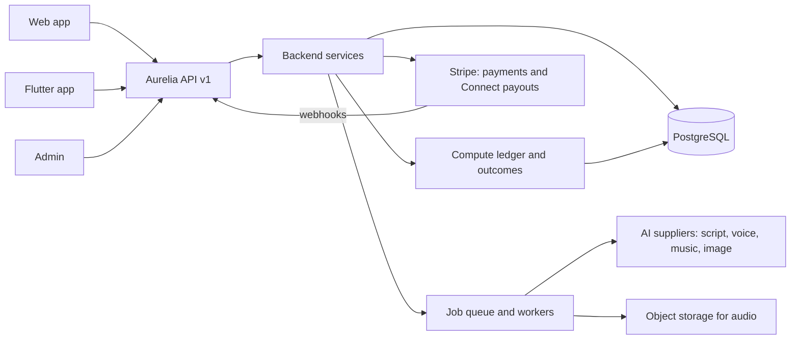

# API contract v2: General

*API contract v2, the Pilot slice (draft for the feature lock). Three pages: [General](/wiki/api) · [Apps](/wiki/api/apps) · [Admin](/wiki/api/admin). The older full contract: [v1](/wiki/api/v1).*

| | |
| --- | --- |
| Version | 2.0 (draft) |
| Status | For review and sign-off at the feature lock. Not implemented; both apps still run on sample data. |
| Replaces | Nothing yet. The [full contract (v1)](/wiki/api?v=1) stays as the long-term map; v2 is what gets built first. |
| Machine-readable form | [`openapi-v2.yaml`](openapi-v2.yaml) (OpenAPI 3.1) |
| Last updated | 24 November 2026 |

## 1 · In one minute

**What v2 is.** The smallest API that lets Aurelia run its **first paid creator pilot**: 3 to 5 creators each sell a retreat ticket to their audience, buyers sign up, build and play sessions, check in before and after, and some move on to Plus. Everything the pilot does not need waits.

**What changed since v1, and why.** The v1 contract described the whole product: community, challenges, coins, invites and 18 admin modules, built in five phases. Since then four decisions changed what the backend must serve first:

- **The business needs a paid pilot before the whole product.** So v2 is one "Pilot slice" phase after Foundation, not P0 to P4.
- **The creator retreat was redesigned and approved.** A one-off ticket (€19.99 or €39), Aurelia as the seller (merchant of record), a 70/30 split paid to creators in money, plus a share of the Plus revenue each cohort brings. That needs one-off payments and Stripe Connect payouts, which the backend plan wanted to retire. v2 keeps them.
- **Safety cannot wait for the last phase.** People type how they feel into free text, so crisis messages are certain. The safety check, the crisis response and the safety log are part of the core loop.
- **The business wants to know what moving someone from a bad state to a good one costs, and whether it works.** Every build now records what it bought from which AI supplier and at what cost (the compute ledger), and every chapter records a check-in score before and after (therapeutic outcomes). This is internal measurement, aggregate only, never public claims.

**The rule: features are locked before the final API.** Every feature that stores data costs an endpoint, a table, backend logic with tests, and changes in both apps. So:

1. The product owner and the business owner sign off a one-page list of what API v1 serves (this slice, plus anything agreed) **before** engineering plans the final API.
2. A change after the lock first gets an **impact note** from engineering (endpoints, tables, screens, days added). Then the product owner decides.
3. Once live, the API changes by **versions, not edits**: new fields and endpoints are added; anything breaking goes to the next version.
4. The prototype may keep moving on sample data. The API does not.

## 2 · How the pieces fit

| Piece | What it is | Today |
| --- | --- | --- |
| The apps (web, Flutter, admin) | What people see and tap | Built, on sample data |
| The API | The list of questions the apps may ask, and the exact shape of each answer | This document |
| The backend | Stores accounts and check-ins, runs the AI, takes payments, keeps data safe | Not built for 2026 |
| Database and suppliers | PostgreSQL, AI models (script, voice, music, image), object storage, Stripe | Chosen, not set up |

All AI runs on the server. The apps never hold a model key or a payment secret.

## 3 · Conventions

Carried from v1 (§3 there), trimmed to what the slice uses.

- **Base path** `https://api.aurelia.care/v1` (staging `https://api.staging.aurelia.care/v1`). The API's own first version is `/v1`; "contract v2" is the second draft of the document, not a `/v2` path.
- **JSON, camelCase** field names, RFC 3339 UTC timestamps, durations in seconds, money as **integer minor units with a currency** (`{ amount: 1999, currency: "EUR" }`).
- **Ids** are opaque strings with a type prefix: `usr_`, `cns_`, `cnv_`, `msg_`, `bld_`, `ses_`, `chp_`, `ver_`, `bit_`, `ply_`, `chk_`, `jrn_`, `crt_`, `ret_`, `coh_`, `enr_`, `ord_`, `ref_`, `spl_`, `pay_`, `sub_`, `cmp_`, `sfe_`, `aud_`.
- **Auth:** `Authorization: Bearer <JWT>`, 15-minute access token; an opaque rotating refresh token (30 days rolling) in an httpOnly cookie on web and secure storage on mobile. Roles: `user`, `creator`, and staff roles on a separate admin audience (`aud: admin`).
- **Errors:** RFC 9457 problem details with a stable `code` the apps switch on, and `retryable`. Codes used by the slice: `invalid_request` (400), `unauthenticated` (401), `forbidden` (403), `not_found` (404), `conflict`, `build_in_progress`, `already_enrolled` (409), `unsafe_content`, `consent_required`, `age_restricted`, `withdrawal_consent_required` (422), `rate_limited`, `build_limit_reached` (429), `ai_unavailable`, `payment_unavailable` (503).
- **Pagination:** cursor, `?limit=20&cursor=…` → `{ data: T[], nextCursor: string | null }`, `limit` ≤ 100.
- **Idempotency-Key** (a UUID) is **required** on every payment, refund, build, check-in and message POST; webhook handlers deduplicate on the supplier's event id. A replay returns the first result for 24 h.
- **Rate limits** per token: 60 requests/min general, 20 messages/min, 10 builds/hour, 5 checkouts/hour. `RateLimit-*` headers; `Retry-After` on 429.
- **Streaming:** Server-Sent Events for the assistant's reply and a build's progress. Streams end with a terminal event; the resource fetched by id is always the truth.
- **Versioning:** additive changes (new fields, new enum values) are not breaking; apps ignore unknown fields and treat unknown enum values as "other". Breaking changes need a new path version.
- **Headers:** `Aurelia-Client: web/<version>+<commit>` or `ios/…`, `android/…` on every request.

**Status labels below:** **v1** = in the v1 contract as it was; **changed in v2** = in v1, with a different shape or rule; **new in v2** = not in v1.

## 4 · The Pilot slice, where to find it

The endpoints are split into two pages:
- [Apps](/wiki/api/apps): what the web and Flutter apps call. Accounts and consent, the core loop, safety, the creator retreat, Plus.
- [Admin](/wiki/api/admin): what staff and internal tools call. The compute ledger and cost, therapeutic outcomes, minimum admin.

### Endpoint count

| Area | Endpoints |
| --- | --- |
| Accounts and consent | 12 |
| Core loop | 22 |
| Safety | 2 |
| Creator retreat | 17 |
| Plus subscription | 6 |
| Compute ledger and cost | 5 |
| Therapeutic outcomes | 3 |
| Minimum admin | 9 |
| Healing model (StateFlips, AKPs, chapters, check-ins; mostly admin-only) | 12 |
| **Total** | **88** |

## 5 · Data model (PostgreSQL)

UUID-backed ids with the prefixes above; `created_at` and `updated_at` on every table; money as `bigint` minor units plus `char(3)` currency. Health data (check-ins, feelings, messages) sits in its own schema with stricter access and is never joined into creator views.

| Table | Key fields | Notes |
| --- | --- | --- |
| `users` | id, email (unique), password_hash?, name, birth_year, country, locale, time_zone, status, deleted_at | Age band derived from birth year |
| `auth_identities` | user_id, provider, provider_user_id (unique pair) | Google in the slice |
| `refresh_tokens` | id, user_id, hash, family_id, expires_at, revoked_at | Rotation with reuse detection |
| `consents` | user_id, purpose, granted, text_version, updated_at | Append-only history in `consent_events` |
| `consent_events` | user_id, purpose, granted, text_version, at, ip_country | Proof of consent |
| `data_requests` | id, user_id, kind (export, delete), state, ready_at | GDPR requests |
| `conversations` | id, user_id, session_id?, source, title | |
| `messages` | id, conversation_id, role, text, safety_flag, attachment jsonb | Health schema |
| `sessions` | id, owner_id, retreat_id?, title, summary, current_version_id | |
| `session_versions` | id, session_id, label, parent_version_id?, bite_ids, state, build_id | Rollback flips `current_version_id` |
| `chapters` | id, version_id, index, minutes, duration_sec, audio_key, image_key, segment_ids | Segments may be reused across buyers |
| `media_segments` | id, retreat_id?, kind, object_key, hash | "Produced once": shared creator-voice segments |
| `lego_bites` | id, kind, title, what, why, params jsonb, active | The catalogue of changes |
| `builds` | id, session_id, version_id, user_id, state, counted, idempotency_key (unique), started_at, finished_at | |
| `compute_ledger` | id, build_id, chapter_id?, media, supplier, model, unit, units, unit_price, cost, currency, cache_hit, reused, latency_ms, attempt, fallback_from | One row per supplier call; append-only |
| `supplier_endpoints` | id, supplier, model, media, unit, unit_price, active, valid_from | Versioned prices |
| `plays` | id, user_id, chapter_id, version_id, started_at, position_sec, completion_ratio, completed, report | Complete only at ≥ 0.3 |
| `checkins` | id, user_id, journey_id?, chapter_id?, phase (pre, post), score (0–100), feeling? | Health schema |
| `journeys` | id, user_id, domain, from_state, to_state, start_score, target_score, status, flipped_at? | State-flip journeys |
| `therapeutic_outcomes` | id, journey_id, chapter_id, pre_score, post_score, uplift, consented | Derived per chapter; only with `outcome_research` consent |
| `safety_events` | id, user_id, source, source_id, category, severity, action, state, owner_id, escalated_at | Kept even after account deletion, de-identified |
| `creators` | id, user_id, handle (unique), display_name, country, stripe_account_id, payouts_enabled | |
| `retreats` | id, creator_id, title, price_amount, currency, split_rule_id, weeks, status | |
| `cohorts` | id, retreat_id, starts_at, enrol_until, capacity, status | |
| `enrolments` | id, cohort_id, user_id, order_id, journey_id, status | Unique (cohort_id, user_id) |
| `orders` | id, user_id, cohort_id, amount, vat, fees, net, currency, state, stripe_payment_intent_id, withdrawal_waived, withdrawal_consent_at, withdrawal_text_version, idempotency_key | Aurelia is merchant of record |
| `refunds` | id, order_id, amount, reason, state, stripe_refund_id, actor_id | |
| `split_rules` | id, version, creator_ticket_share, creator_plus_share, plus_attribution_days, effective_from | Never edited in place |
| `payout_ledger` | id, creator_id, source, order_id?, subscription_invoice_id?, gross, creator_amount, state, available_at, stripe_transfer_id?, paid_at? | Append-only; reversals are new rows |
| `subscriptions` | id, user_id, plan, interval, status, current_period_end, stripe_subscription_id, attributed_cohort_id? | |
| `usage_counters` | user_id, day, builds_used | Free-limit counter |
| `webhook_events` | id (supplier event id, unique), source, type, received_at, processed_at, error? | Deduplication |
| `stateflips` | id (SF-…), n, dimension, title, need jsonb, bad, good, milestones jsonb, measure jsonb, issues, layer, status, version | Versioned; apps see `published` only (§4.9) |
| `akps` | id (WG-/ID-/WS-/WM-/WI-/WV-/PR-…), name, family, fn, kind (goal, strategy), layer, modality, description, causal_role, source, status, version | Admin-only |
| `akp_links` | from_akp, to_akp, type (step-of, feeds, part-of, supports, fed-by, mirrors) | Unique triple |
| `akp_flips` | akp_id, flip_id | Which StateFlips an AKP serves |
| `chapter_akps` | chapter_id, akp_id, order, kind | A chapter is its AKPs in order |
| `checkin_measures` | checkin_id, marker, value | Health schema; `checkins.score` is their sum |
| `tournaments` | id, flip_id, chapter_id?, media, judge, winner_candidate_id, baseline_score?, uplift_after?, decided_at | Admin-only |
| `tournament_candidates` | id, tournament_id, supplier, model, akp_ids, score, cost, currency | |
| `persona_identities` | persona_id, dims jsonb, archetype, cog_style, value, spiritual, flags, flip_id, mindspace jsonb | Synthetic personas only |
| `staff_users` | id, email, role, status | Admin audience |
| `audit_log` | id, actor_id, action, target, before jsonb, after jsonb, at | Append-only |
| `idempotency_keys` | key, user_id, route, response_hash, created_at | 24 h replay |

## 6 · Webhooks and events

**Inbound** (to the API):

| Source | Event | What the server does |
| --- | --- | --- |
| Stripe | `checkout.session.completed` (ticket) | Order → paid; enrolment, journey and pending payout line created; receipt and withdrawal confirmation emailed |
| Stripe | `checkout.session.completed` (subscription), `invoice.paid` | Subscription active; entitlements updated; `plus_share` payout line if attributed |
| Stripe | `customer.subscription.updated` / `.deleted` | Status and entitlements updated |
| Stripe | `charge.refunded` | Refund row; enrolment refunded; payout reversal line |
| Stripe Connect | `account.updated` | `payouts_enabled` on the creator |
| Stripe Connect | `transfer.created`, `payout.failed` | Payout line → paid, or flagged in admin |

Every handler verifies the Stripe signature, deduplicates on the event id in `webhook_events`, and is safe to replay.

**Internal events** (queue topics, not public): `build.completed`, `build.failed`, `checkin.created`, `journey.flipped`, `safety.flagged` (pages the escalation owner when severity is `crisis`), `order.paid`, `payout.due`. Outbound partner webhooks are out of v2.

## 7 · Explicitly out of v2 (later)

| Out | Why it waits |
| --- | --- |
| Community: publish, recreate, shelves, creator follow | Not needed to sell or deliver a retreat |
| Challenges, coins, wallet, invites | The economy follows the pilot's results |
| Most admin modules (moderation queue, AI policy console, experiments, notifications broadcast, signal sources, compliance dashboard) | The pilot runs by hand; the slice keeps only §4.8 |
| Wearables and signal sources (Apple Health, Whoop, Oura) | Check-in scores are enough to measure the pilot |
| Healing Map and the learning graph (Causal AI reinforcement, pruning, tournaments) | Needs real outcomes first; the ledger and outcomes tables collect them |
| Insurer, employer and clinical reporting | A separate regulatory track |
| Apple sign-in, store billing on mobile | Web checkout first; Apple sign-in becomes required when the iOS app offers Google |
| Video generation | Cost (37% of measured 2025 spend) for little gain |
| Voice input, push notifications, outbound webhooks | After the pilot |

## 8 · Open decisions before the lock

| Decision | Options on the table | Blocks |
| --- | --- | --- |
| Price anchors | Retreat ticket €19.99 or €39; Plus $10 a month or $100 a year; the cost model's $19.99 per flip | Plans, checkout, the split examples |
| Free-limit unit | Builds per day (v1), chapters, or minutes of audio | Entitlements, usage counters |
| First pilot market | EU (withdrawal, VAT, GDPR) or Indonesia | Currencies, VAT, crisis lines, data region |
| Safety escalation owner | A named person or rota who receives crisis events, with hours and a backup | Going live at all |
| Data region | EU only, or EU plus a second region for Indonesia | Hosting, suppliers, the DPIA |
| Minimum group size | 10 (proposed) or 5 | Creator and admin aggregates |
| Creator share of Plus | 20% of year-1 Plus (proposed), and the attribution window | Split rules, payouts |
| One voice supplier and one fallback | From the cost model's shortlist | Build pipeline, ledger prices |

## 9 · Change from v1

| | What | Detail |
| --- | --- | --- |
| **Moved** | Safety | From the last phase (admin monitoring) into the core loop: blocking check, crisis reply, events, escalation |
| **Moved** | Phasing | P0 to P4 → Foundation, then one Pilot slice; the rest after the pilot |
| **Moved** | One-off payments, Stripe Connect | Kept for the creator retreat instead of retired |
| **Changed** | Proposals | "Change this session" is now a list of Lego bites; applying makes a new version, with rollback |
| **Changed** | Sessions | Chapters (3, 5 or 10 minutes) inside versions; playback per chapter |
| **Changed** | Check-ins | A pre and a post score from 0 to 100 on each chapter |
| **Changed** | Journeys | Start score, target and a flipped state |
| **Changed** | Plays | Completion ratio and an adverse report |
| **Changed** | Sign-up | Age gate and country |
| **Added** | Creator retreat | Creators, retreats, cohorts, enrolments, ticket orders, withdrawal consent, split rules, payout ledger, refunds, Plus attribution, cohort aggregates |
| **Added** | Compute ledger | Per supplier call: media, supplier, model, units, cost, cache hit, reuse, latency |
| **Added** | Therapeutic outcomes | Flip rate, chapters to flip, uplift per chapter, aggregate only |
| **Added** | Feature lock | Changes after the lock need an impact note and a decision |
| **Dropped from the first build** | Community, challenges, coins, wallet, invites, signal sources, notifications, studies, most admin modules, Apple sign-in, store billing, video | Still in the [v1 contract](/wiki/api?v=1) as the long-term map |

Where this document and `openapi-v2.yaml` disagree, this document is right.
