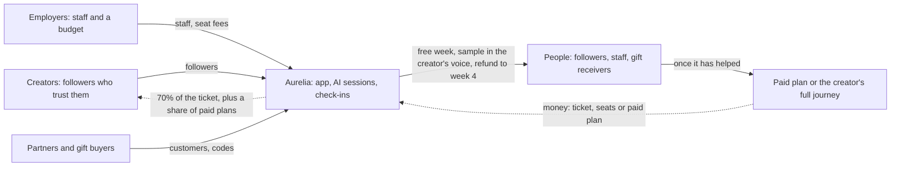

# B2B2C: ideation, plan and research

*Asked by the business owner: "B2B2C ideation, plan, research". Round 1 was researched 23–24 Nov 2026 in five research tracks: about 330 links in the research notes, 184 of them cited on the detail pages. **Round 2** (25 Nov 2026) added 28 new web sources and the results of two buyer tests, re-ranked the channels and listed the features to build. This page is the summary. Every claim on it is backed on a detail page, linked below, and every detail page lists its own sources.*

> **Round 2 changes the answer's first step.** Build the creator journey first, but with a **free first week**: people pay for the creator's journey or the paid plan after it has helped, not before. Two buyer tests with simulated people found that freemium beat a ticket paid up front in every channel, and that trust, not price, was the main objection. The **self-serve team plan for small employers moves up to second**, because 21 of 60 simulated people would buy if their employer paid. Partner codes and gifting move to third, built as one code system. Read [Round 2](/wiki/b2b2c/round-2) and the [feature list](/wiki/b2b2c/features). The round 1 answer below stands except where round 2 says otherwise.

## The big picture

Creators, employers and partners already have the people. Aurelia gives those people a free start they can trust; they pay once it has helped, and the money is shared with the creator. The same picture, with every box explained, is at the top of the B2B2C report in the admin.

Solid arrows are people and reach; dotted arrows are money.

## The answer in one paragraph

Aurelia should go to market through people who already have the customer, because buying users with ads does not pay back. The median Health & Fitness app turns 2.9% of installs into payers, which puts a paying subscriber at about $100–170 in media alone. **The best first bet is the business owner's creator cohort, Retreat-in-a-Box, but with redesigned terms.** "Redesign" here means the business model, not the app's screens: the price, the split, how the sessions are made and the box. As specified, it breaks on four numbers:

- **The split.** Creators keep 87–97% on course platforms; 60% will be resisted.
- **AI cost against the ticket.** Aurelia's €6.45 share of a €19.99 web ticket is less than 24 fully personalised sessions with a premium voice cost (about $13).
- **The box.** A modest kit costs about $14–28 delivered (fulfilment alone $9–18), most or all of the ticket.
- **Week-8 activity.** 76.5% active at week 8 is about 16 times what mindfulness apps keep at day 30.

Beside it, test a cheap self-serve team tier for small employers and one trial-code partner. Insurers and clinical routes come last, if ever. The spec's "+85.7% sleep" and "stress −50%" come from mock data and must never be used.

## What to read, and what the research covered

| Page | What it covers | Sources |
| --- | --- | --- |
| [Ideation](/wiki/b2b2c/ideation) | 15 B2B2C models for Aurelia, scored on six questions; how Retreat-in-a-Box changes | Our scoring, from the pages below |
| [Creators and cohorts](/wiki/b2b2c/creators) | How Insight Timer, Maven, Patreon, Kajabi and others pay creators; normal splits; cohort completion; wellness retention; refunds; filling 200 seats; the physical box | 37 |
| [Employers and insurers](/wiki/b2b2c/employers) | Employer pricing (Headspace, Calm, Wysa, Lyra, Spring, Unmind); activation; what buyers demand; insurers, DiGA, the NHS; why Headspace, Calm and Pear struggled; Southeast Asia | 49 |
| [Partners](/wiki/b2b2c/partners) | Hotels and airlines, gyms, telcos and bundles, wearables, gifting and brands, universities; which deals produced payers and which only reach | 34 |
| [Unit economics](/wiki/b2b2c/economics) | Conversion, retention, prices, store and payment fees, VAT, AI cost per session, acquisition cost; the €19.99 ticket and a per-100-buyers model | 30 |
| [Claims and regulation](/wiki/b2b2c/regulation) | Wellness against medical device (EU, UK, US, Indonesia); the EU AI Act; creator advertising; health data; payments; crisis handling; what a creator may say | 34 |
| [Plan](/wiki/b2b2c/plan) | Phases, gates and the five numbers that decide the pilot; how it plugs into the admin | From the pages above |
| [Roast](/wiki/b2b2c/roast) | What a sceptical investor, a creator, a regulator and the business owner attack in this research, and what changed | — |
| [Full report and sources](/wiki/b2b2c/sources) | The deep research report, unedited, with its inline sources | All five tracks |
| [Round 2](/wiki/b2b2c/round-2) | What changed since round 1 and why; the channels re-scored with the simulations; employer, Indonesia, creator-platform and trust research of 2025–2026; the phased plan tied to the gates | 28 new, plus our own documents |
| [Features to build](/wiki/b2b2c/features) | Every feature per channel (free plan, creator journey, team plan, codes and gifts): who, the problem, evidence, priority, effort against API v2, success number | From round 2 |

**Not covered, and why:**
- **Exact deal terms.** Partner wholesale prices and creator contracts are private.
- **Results nobody publishes.** There is no data on paid programmes converting to subscriptions, or on the share of a creator's followers who buy.
- **Indonesia's implementing rules.** The detailed rules under its data-protection law were not found.

These gaps are listed at the end of each page. They are what the pilot has to measure itself.

**How sure we are.**
- **Firm:** peer-reviewed and large-dataset figures, and companies' own published prices and fees. Examples: Baumel et al. on retention, RevenueCat's 115,000-app panel, Maven's and Patreon's fees, Wysa's price, the regulators' own documents.
- **Leads, not facts:** figures taken from a search result rather than a fetched page. They are marked "search summary" on the pages (24 places) and need one check before they go into a deck.
- **Our judgement, labelled as such:** the ideation scores, the scenario inputs and the pilot thresholds.

## Ideation: the models, ranked

| Rank | Model | Score / 18 | In one line |
| --- | --- | --- | --- |
| 1 | Trial codes and gifting | 16 | Hotels, brands and gift buyers pay for reach; codes convert at retail with the user's own card |
| 2 | **Creator cohort, redesigned** | 15 | The creator's audience is the marketing; Aurelia must win on the personal, in-their-voice journey |
| 3 | Retreat and studio aftercare | 14 | "Your retreat continues as chapters": luxury retreats follow up with people, not apps, today |
| 4 | Team tier for small employers | 13 | About $50–70 a seat a year, self-serve, aggregate reporting only |
| — | Insurers, DiGA, the NHS | 6–7 | Need clinical evidence and would make Aurelia a medical device |

The full table of 15, with the scores per question, is on [Ideation](/wiki/b2b2c/ideation).

## What the research found

**Creators and cohorts** ([details](/wiki/b2b2c/creators))
- Platforms take 0–10% when the creator brings the buyers: Maven 10%, Patreon 10%, Teachable 0–7.5%, Kajabi 0% plus card fees. Insight Timer, which brings the audience itself, pays teachers from a pool by plays and publishes no percentage.
- At €19.99 and 60%, a full 200-seat cohort earns a creator about €1,936. Big creators will not bother, and small ones cannot fill 200 seats. No credible "share of followers who buy" exists.
- The famous 75–96% cohort completion rates come from expensive, live programmes and are unaudited. Measured: 12.6% for MOOCs, about 60% for fee-paying learners.

**Employers and insurers** ([details](/wiki/b2b2c/employers))
- Content-only apps sell at about $50–70 a seat a year (Wysa lists $50; Calm Teams is reportedly about $70). Clinical vendors charge far more, but bundle therapy.
- Activation decides renewals. In one measured study, 38% of enrolled employees used any digital tool, and 44% never opened the app.
- Insurers bundle wellness apps as cancellable perks, not reimbursed care. Real reimbursement (Germany's DiGA) is only for certified medical devices.
- The category is shrinking. Headspace, valued at about $3 billion in 2021, is selling to Sword Health for up to $300 million, and Pear Therapeutics sold its assets for $6.05 million.

**Partners** ([details](/wiki/b2b2c/partners))
- Deals lasted where the end user enters their own card: Hyatt's trial that renews at retail, Singtel's carrier billing, and Oura's integration that needs Headspace's own subscription.
- Free placements lapsed: American Airlines' seatbacks, Spotify × Headspace, and Calm on Samsung TVs.
- Two openings: retreat aftercare, and Indonesia, where no global meditation app has a carrier or super-app deal.

**Unit economics** ([details](/wiki/b2b2c/economics))
- The voice is the cost, not the script: a personalised 10-minute session costs about $0.10–0.55. Pauses are free.
- 30% of graduates to Plus is plausible next to the 37.7% median trial-to-paid rate. The number that decides the plan is **Plus per ticket buyer**, which depends on how many finish.
- Per €19.99 web ticket, Aurelia keeps about €6.45 before AI. A shared, pre-produced creator journey keeps nearly all of it; 24 personalised sessions on a premium voice turn it into a loss of about €6.75 (estimates).
- Per 100 ticket buyers: about 3, 10.5 or 23 Plus subscribers in the low, middle and spec cases. A full wave of 50 creators × 200 seats would give roughly 300, 1,050 or 2,300 (estimates).

**Claims and regulation** ([details](/wiki/b2b2c/regulation))
- In every market, what you claim decides whether you are a medical device. Under UK guidance, a creator's social posts implying the app reduces depression can make it one.
- A sentence about how you feel is health data. Creators and employers see only aggregate numbers, and no ad pixel may sit on a feelings screen. The US fines in this area (BetterHelp $7.8M, GoodRx $1.5M) followed exactly that pattern.
- Crisis handling is mandatory: California SB 243 requires a suicide-prevention protocol, and Illinois and Nevada ban AI that presents itself as therapy. The EU AI Act bans emotion inference at work.

## The plan in brief

The full plan, with gates, is on [Plan](/wiki/b2b2c/plan).

The business owner's scale claims (120,000 AKPs, 500 billion variations, 5 billion StateFlips, $1 per flip) are recorded as [his thesis, not measured](/wiki/b2b2c/owner-thesis), each with what would make it measurable.

1. **Phase 0, now, no backend.**
   - Buyer agents test the redesigned retreat (€19.99 against €39).
   - The business owner interviews five to ten creators.
   - Draft the claims pack and the creator contract.
   - Build the admin prototype on sample data marked as targets.
2. **Phase 1, after a minimum backend** (accounts, payments with Aurelia as merchant of record, consented storage, crisis flow): a paid pilot with three to five creators. In parallel, a team tier with two or three small employers and one trial-code partner.
3. **The five pilot numbers, set in advance:**
   - median seats sold of at least 100;
   - at least 35% active at week 8;
   - Plus from at least 8% of ticket buyers;
   - refunds under 10%;
   - AI and payment cost under a third of Aurelia's share.
4. **Then widen:** 20 creators, then 50; a wearable integration; carrier billing in Indonesia.

## Decisions for the business owner

1. Approve Phase 0, and who interviews creators.
2. The redesign: 70/30 plus a share of the Plus each cohort drives, a pre-produced journey in the creator's voice, a digital welcome kit.
3. Which ticket price to test.
4. The pilot's first market, which decides the claims rules, VAT and the crisis numbers shown.
5. When the minimum backend is built, and by whom.
6. Confirm that insurers and clinical claims are out of scope for now.

*How this was made: five parallel research tracks, each saving sourced notes in `docs/research/research_notes/Aurelia B2B2C models and plan/`, then one report written from all five ([Full report](/wiki/b2b2c/sources)). The detail pages break each track out, and the ideation, plan and roast are our own analysis on top. Figures marked "estimate" or "our judgement" are not benchmarks.*
