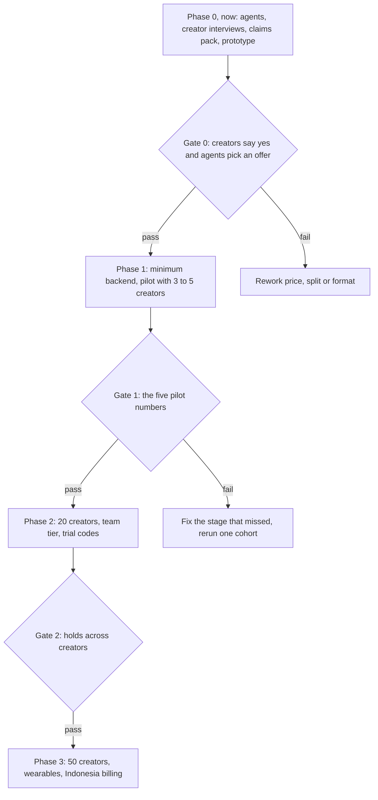

# Plan: what to test first, in what order, and the gates

*Part of the [B2B2C research](/wiki/b2b2c). A proposal for Eugene and the product owner to decide. The thresholds are our judgement, set in advance so the results cannot be argued after the fact; none is a published benchmark.*

## In one minute

- **One bet, two cheap side tests.** The bet is a small paid creator pilot, redesigned from Retreat-in-a-Box. Beside it run a self-serve team tier with two or three small employers, and one trial-code partner.
- **Phase 0 needs no backend** and can start now: buyer agents test the offer, five to ten creators are interviewed, the claims and creator contract are drafted, and the admin prototype shows the business on sample data marked as targets.
- **Phase 1 needs a minimum backend**: real accounts, payments with Aurelia as merchant of record, consented data storage, crisis handling. The app has none of these today, and every channel needs them.
- **Five numbers decide the pilot**: seats filled, active at week 8, Plus per ticket buyer, refunds, and cost per buyer. Each miss points to a different fix.
- **Insurers, DiGA, the NHS and any clinical claim stay out of the plan.** They require becoming a medical device, and the category's write-downs show the price of that road.

## The phases

### Phase 0: prove the offer before building it (about 4 weeks, no backend)

| Work | Output | Owner | Where it lives |
| --- | --- | --- | --- |
| **Buyer agent v5**: test the redesigned retreat against plain freemium, with a creator-follower framing. Variants: €19.99 against €39; with and without a digital welcome kit | Which offer the panel prefers, by segment, with objections | Product | Admin → Buyer agent results |
| **Creator interviews**: five to ten wellness creators across two or three countries, Indonesia included | Would they sell it, at what split, at what price, how many seats they can fill; what they need from Aurelia | Eugene | Decision log in Business funnel |
| **Claims pack**: an intended-purpose statement (wellness only), an approved-claims list with no mock percentages, the creator contract terms | Ready before any ticket is sold | Product owner, with counsel | Wiki, this research |
| **Admin prototype**: the network overview, the curriculum view and outcomes, on sample data marked as targets, in our design system (O45) | Something to show creators and investors | Product | Admin, staging first |
| **Answer O45**: who the prototype is for, the founding creators, the box, what the ticket includes, the curriculum against the five-chapter journey | Decisions | Eugene | Work journal, O45 |

**Gate 0.** At least three creators say they would sell a pilot cohort on terms Aurelia can afford, and the buyer agents prefer one offer variant clearly enough to pick it. If creators refuse every split under 70/30, move to 70/30 plus a Plus share. If none will sell at any terms, the retreat is not the first channel, and the team tier and trial codes lead instead.

### Phase 1: the pilot (8 weeks of cohort, after the minimum backend)

**The minimum backend, which every channel needs:**
- real accounts;
- payments through web checkout, with Aurelia as merchant of record, EU early-supply consent captured and refunds run centrally;
- consented storage of check-ins;
- an aggregate creator dashboard with minimum group sizes;
- a crisis detection and referral flow;
- an age gate;
- no ad pixels on any feelings screen.

**The pilot:**
- three to five creators;
- a pre-produced creator journey with personal inserts;
- at least one creator offered 70/30 plus a share of the Plus revenue they drive.

| Number | Threshold | If it misses, the constraint is |
| --- | --- | --- |
| Median paid seats per cohort | at least 100 | The creators' reach: smaller cohorts, or more creators per wave |
| Active at week 8 | at least 35% | The product: the journey, the check-in, the reminder (Business funnel → staying) |
| Plus per ticket buyer | at least 8% | The handover: the offer at graduation, the price step from €19.99 to $10 a month |
| Refunds | under 10% | Expectations set by the creator's sales copy |
| AI plus payment cost per buyer | under a third of Aurelia's ticket share | Voice choice, reuse, and how much is personalised |

**In parallel, cheaply:**
- a self-serve team tier at about $50–70 a seat a year with two or three small employers, reporting activation and 30-day retention against eligible staff;
- one trial-code partner (a boutique studio, a retreat operator or a gift buyer), with codes that convert at retail and a card on file.

### Phase 2 and 3: repeat, then widen

- **Phase 2:** 20 creators, only if Gate 1 passes on at least three of five numbers and on Plus per buyer. The team tier continues if activation beats the 38% measured in employer benefits. A second partner type is added.
- **Gate 2:** the numbers hold across creators, not only for the best one.
- **Phase 3:** 50 creators; a wearable integration that sells Aurelia's own subscription; a carrier-billing pitch in Indonesia, once there is retention data to show.

## How it plugs into what the admin already has

| Admin tool | Its job in this plan |
| --- | --- |
| **Business funnel** | The pilot's scoreboard: entry is a ticket sold, aha is the first session, the cap and Plus are the graduation offer, staying is week 8. The pilot's real numbers replace the agents' prediction in the human column. |
| **Buyer agent results** | Phase 0's offer test (v5), and later a prediction to compare with each real cohort |
| **User journey** | The retreat's moments, with the creator's touchpoints tagged |
| **Experimentation (feedback group)** | Becomes the first paid cohort, per Eugene's "commercially aligned" note |
| **Decision log** | Each gate's result and what changed |

## Decisions needed from Eugene and the product owner

1. Approve Phase 0, and name who interviews creators.
2. Is the redesign acceptable: 70/30 plus a Plus share, a pre-produced journey, a digital kit?
3. The ticket to test: €19.99 only, or also a higher price?
4. The pilot's first market: EU, UK, US or Indonesia. This decides the claims rules, VAT and the crisis numbers to show.
5. The minimum backend: when, and who builds it. Nothing in Phase 1 can start without it.
6. Confirm that insurers and clinical routes are out of scope for now.
