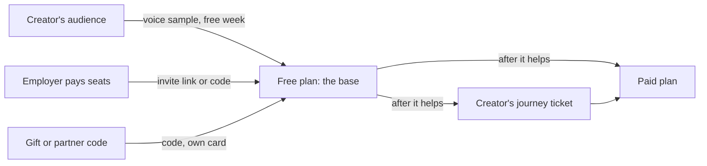
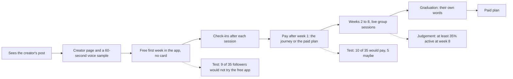
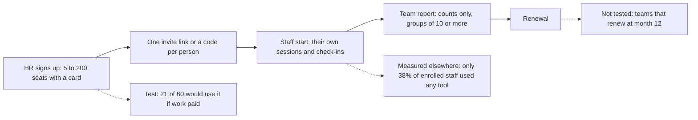
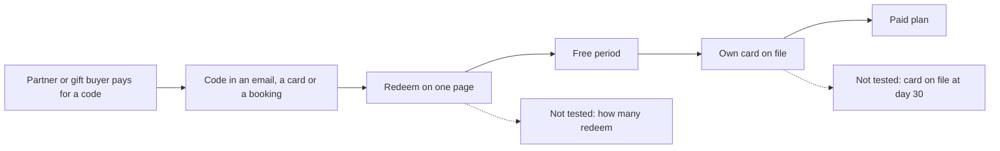
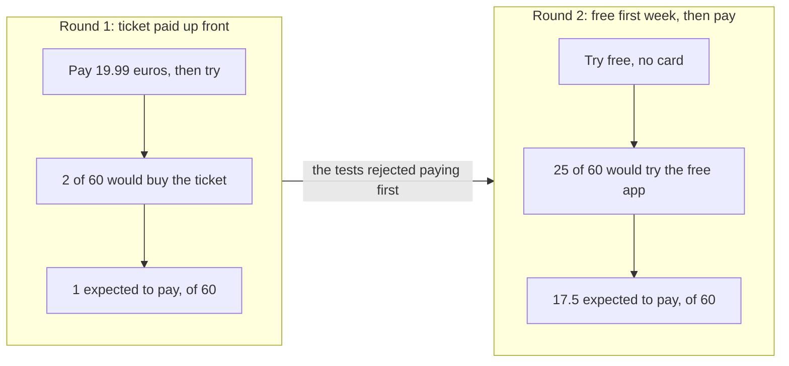
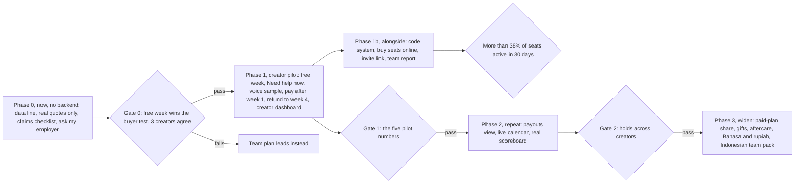

# Round 2: what changed, what to build

*Part of the [B2B2C research](/wiki/b2b2c). Researched 25 Nov 2026: 28 new web sources, read as of late 2026, plus everything already known: round 1, the business owner's retreat brief and mock-up, Insight Timer round 3, buyer tests 6 and 7, the retreat funnel, the cost report and API v2. Every new fact carries its link, its date and one label: **measured**, **company claim**, **third-party** or **estimate**. The scores and priorities are our judgement. The feature list is on [Features](/wiki/b2b2c/features); the same answer is in the admin under Reports → B2B2C report.*

## The answer in one paragraph

**Build the creator journey first, but make the first week free.** People pay for the creator's journey, or for the paid plan, after it has helped them, not before. Round 1 put a ticket paid up front at the door. Two tests with simulated people say almost nobody pays a stranger's ticket before trying, and that freemium brought more paying people in every channel. The creator stays the right first partner, because the business owner's purpose for the retreat is reach (creators → people using Aurelia → paid plans), and because "trust" was the top objection: followers trust their creator, not an unknown AI app. **Second, a self-serve team plan for small employers**, which moves up from fourth: 21 of 60 simulated people named "my employer pays" as a reason to buy, and Wysa, Calm and Headspace all still sell small teams online at about $50–70 a seat a year. **Third, partner codes and gifting**, built once as one code system that the team plan needs first.

## What changed from round 1, and why

| Round 1 said | Round 2 says | Why it changed |
| --- | --- | --- |
| The creator retreat, redesigned: a €19.99 ticket up front, then the paid plan at week 8 | The creator journey with a **free first week**; the ticket or the paid plan after it | Test 6 (60 simulated people): the free app gave 17.5 expected paying people, the €19.99 ticket 1, the €39 ticket 0.5. Test 7 (100): among 35 creator followers, the free app 12.5, the ticket 4. Simulated, not measured. |
| Trial codes and gifting first (16 of 18) | Third, and built as one code system | Nothing tested it; API v2 has no code endpoints; the free placements in round 1 lapsed. Still cheap, still the person's own card. |
| Team tier for small employers fourth (13 of 18) | **Second** | 21 of 60 simulated people would buy if work paid, more than any offer moved. The big apps keep the small self-serve tier while moving up-market. |
| Retreat and studio aftercare third | Later | A real gap (Insight Timer's retreats end at the retreat), but it needs in-person retreat leaders and the same backend first. |
| Price was the main problem | **Trust** is the main problem | Test 6's top objection to the retreat was trust (25), before access (11) and price (10). The creator's own voice moved 5 answers, more than any other change. |
| Insurers and clinical routes out | Still out, more clearly | Headspace is being sold to an AI care company for up to $300M; Calm Health sells through health plans to 39M+ people. That market now buys clinical care. |

## The channels, re-scored

Round 1 scored fifteen models on six questions (out of 18): who pays to find the user, who owns the card, time to revenue, build, risk, fit. Round 2 keeps those six and adds a seventh, **what the simulations say** (0–3), so the total is out of 21.

| Rank | Channel | Six questions (of 18) | Simulations (of 3) | Total (of 21) | Round 1 |
| --- | --- | --- | --- | --- | --- |
| 1 | **Creator journey, free first week** | 15 | 2 | **17** | 2nd, 15 |
| 2 | **Self-serve team plan for small employers** | 13 | 3 | **16** | 4th, 13 |
| 3 | **Partner codes and gifting** | 15 (build drops 3 → 2: no endpoints yet) | 0 (not tested) | **15** | 1st, 16 |
| — | Creator ticket paid up front | 15 | 0 | 15 | became an upgrade inside rank 1 |
| — | Retreat and studio aftercare | 14 | 0 (not tested) | 14 | 3rd, 14 |
| — | Insurers, clinical routes | 6–7 | — | out | out |

**The free plan is not ranked: it is the base.** Every channel lands people in it, and the simulations favoured it in every channel. Its own features (the free first week, "Need help now?", one line on data) come first on the [feature list](/wiki/b2b2c/features).

## How it works, channel by channel

What the person sees at each step, and where people drop off. Numbers marked "test" come from simulated people, not real buyers; "judgement" is a pilot threshold we set; "not tested" is what the pilot has to measure. The admin's B2B2C report draws the same journeys, with every step explained.

**Creator journey, free first week**

**Team plan**

**Codes and gifts**

## Before and after: ticket up front against a free first week

Among 35 creator followers in test 7: 4 expected to pay with the ticket up front, 12.5 with the free app. The free week itself is not tested yet; the free app is the nearest thing that was. Across 115,000 apps, trials of 17–32 days turn 42.5% into payers against 25.5% for trials under 4 days.

## What the new research found

### 1. Employers: the small, self-serve tier is still open

- **The big apps are moving up-market.** Sword Health agreed to buy Headspace for up to $300M ([crypto briefing](https://cryptobriefing.com/sword-health-acquires-headspace/), 2026, third-party). Headspace reaches 7M+ people through Cigna from 1 Jan 2026 ([Cigna](https://newsroom.cigna.com/2025-11-10-Headspace-for-Cigna-Healthcare-Enhances-Everyday-Mental-Health-Support-Through-Self-Guided,-Science-Backed-Resources), 10 Nov 2025, company claim). Calm Health joined the Solera Network and says it reaches 39M+ people ([Calm](https://www.calm.com/blog/calm-health-solera-press), Jan 2026, company claim).
- **The small tier stays self-serve.** Wysa for Teams: $50 per employee per year, up to 200 people, a code per person ([Wysa](https://wysa.com/for-teams), read 25 Nov 2026, company claim). Calm: groups of 5–300, cheaper per seat as the group grows ([Calm support](https://support.calm.com/hc/en-us/articles/360038432493), company claim). Headspace: buy online, share one link ([Headspace](https://organizations.headspace.com/small-business), company claim). Median Calm buyer about $7,880 a year over 51 purchases ([Vendr](https://www.vendr.com/marketplace/calm), third-party): small teams, not enterprises.
- **Budgets exist but must show use.** Only 16% of US employers are cutting wellbeing spend, and buyers now ask for outcomes ([WTW](https://www.wtwco.com/en-us/insights/2026/10/employee-wellbeing-enters-its-next-chapter-smarter-investments-greater-impact), Oct 2026, third-party). 66% plan to invest more in stress and resilience in 2026 ([Wellable](https://www.wellable.co/resources/employee-well-being-industry-trends-report/2026/), third-party). But average spend on mental-health resources fell about 7% in NFP's data ([Insurance Business](https://www.insurancebusinessmag.com/us/news/benefits/nearly-half-of-us-employers-expect-healthcare-budget-increases--nfp-562773.aspx), 2025, third-party). Sources disagree: price low and report activation.

### 2. Indonesia and Southeast Asia

- 48% of Indonesian companies already include an employee assistance programme ([Mercer Marsh Benefits](https://www.marsh.com/id/en/services/employee-health-benefits/insights/id-indonesia-health-and-benefits-study-2025.html), 2025, 400 organisations, third-party). Aurelia goes beside it, not instead of it.
- The corporate wellness market is about $968M in 2025 ([IMARC](https://www.imarcgroup.com/indonesia-corporate-wellness-market), estimate). Another firm says twice that; neither is a fact.
- Creators already sell for commission. Content commerce was 32% of Southeast Asia's e-commerce in 2025 ([Jakarta Post](https://thejakartapost.com/business/2026/06/27/businesses-tap-tiktoks-creator-economy-to-boost-sales), 27 Jun 2026, third-party, summary only). Tokopedia and TikTok Shop train Indonesian creators to earn per sale ([Tokopedia](https://www.tokopedia.com/blog/creators-lab-bali-eng/), Jun 2025, company claim). A creator share is a familiar deal there.
- No count of Indonesian meditation or yoga creators exists. Interviews have to find them.

### 3. Creator platforms in 2026

- Insight Timer keeps growing free-first: India launch, 35M+ users, local teachers ([press release](https://m.thewire.in/article/ptiprnews/worlds-largest-free-wellness-app-insight-timer-launches-in-india/amp), 11 Mar 2026, company claim), and AI recommendations on 16M intentions ([GlobeNewswire](https://www.globenewswire.com/news-release/2026/01/06/3213643/0/en/insight-timer-launches-new-year-s-resolution-and-intention-setting-features-with-ai-recommendation-engine.html), 6 Jan 2026, company claim). Personal recommendations are no longer a moat; a journey in the creator's own voice still is.
- Its retreats take a 10% non-refundable fee and stop at the retreat ([Insight Timer FAQ](https://insight-timer.freshdesk.com/support/solutions/articles/67000739470-insight-timer-retreats-faqs-for-teachers), company claim). Community platforms take 0.5–2% plus card fees ([Circle pricing](https://schoolmaker.com/blog/circle-so-pricing), 2026, third-party). Aurelia's 30% must be visible and earned by the "after".

### 4. Trust: how creator-sold programmes earn it

- **Free first.** Trials of 17–32 days convert 42.5%, under 4 days 25.5%; freemium apps turn 2.1% of downloads into payers by day 35 ([RevenueCat](https://www.revenuecat.com/blog/growth/subscription-app-trends-benchmarks-2026), 2026, measured on 115,000+ apps). Health & Fitness has the best trial-to-paid rate, 35% ([Adapty](https://adapty.io/state-of-in-app-subscriptions-2026), Mar 2026, measured on 16,000 apps).
- **A refund window shown before paying.** Maven refunds in full to the course midpoint and shows it as a badge ([Maven](https://help.maven.com/en/articles/8705540-maven-s-satisfaction-guarantee), company claim); a refund returns both the creator's and the platform's share ([Maven](https://help.maven.com/en/articles/5597391-issuing-refunds-to-students)). For an 8-week journey, that is week 4.
- **People trust people.** 83% trust recommendations from people they know ([Nielsen](https://www.nielsen.com/global-trust-in-advertising), 2021 data, third-party); 26% say they do not trust influencers ([BBB National Programs](https://bbbprograms.org/media/insights/blog/influencer-trust-index), Feb 2025, third-party). The creator's own voice is the bridge.
- **Testimonials only when real.** The US rule on reviews and testimonials, in force since 21 Oct 2024, fines each fake or AI-made testimonial ([FTC](https://www.ftc.gov/news-events/news/press-releases/2024/08/federal-trade-commission-announces-final-rule-banning-fake-reviews-testimonials)). Until the pilot has real participants, the page shows none, and never the spec's mock "+85.7% sleep".

### 5. Creator dashboards

- Kajabi shows revenue, new customers, active members, completion and last activity ([Kajabi](https://kajabi.com/features/analytics), company claim). Teachable shows sales, refunds, fees, payouts and drop-off per lesson ([Teachable](https://teachable.com/blog/new-teachable-reporting-tools-2024), company claim). Aurelia's adds how the group feels, as totals only, for groups of 10 or more.

### 6. Codes and gifting

- Headspace runs gifts, promos and partner vouchers through one code page ([Headspace help](https://help.headspace.com/hc/en-us/articles/215057448-I-have-a-promo-gift-code-How-do-I-redeem-activate-it), company claim). One system serves all three channels.

## What the simulations say, and what they cannot

- **Test 6 (60 simulated people).** Free app: 25 would try, 12 pay, 17.5 expected paying people. The €19.99 retreat: 2 buy a ticket, 1 reaches the paid plan. The €39 retreat: 0.5. Top objections to the retreat: trust (25), access (11), price (10). 21 of 60 would buy if their employer paid; only 4 heard of Aurelia through work.
- **Test 7 (100 simulated people).** A free library raised trying from 51 to 61. Among 35 creator followers, 7 would buy the ticket against 26 trying the free app; expected paying people 4 against 12.5.
- **What they cannot say.** They are AI playing made-up people. They cannot say how many of a real creator's followers buy, or whether a free week is abused. That is the pilot's job.

## The phased plan, tied to the pilot gates

| Phase | When | What is built | Gate |
| --- | --- | --- | --- |
| **0: prove the offer** | Now, no backend | One plain line on data; real quotes only; the creator claims checklist; "Ask my employer to pay"; a buyer test of the free-week creator offer | **Gate 0.** The free-week creator offer beats the free app among followers in the buyer test, and at least 3 creators accept the terms in interviews |
| **1: the creator pilot** | After the minimum backend | Free first week; "Need help now?"; the creator's page with a voice sample; pay after week one; refund to week 4; the creator dashboard | **Gate 1.** The five pilot numbers, with "paid after the free week" (our judgement: at least 15%) in place of "seats sold"; active at week 8 at least 35%; paid plan from at least 8% of starters; refunds under 10%; cost under a third of Aurelia's share |
| **1b: the team plan** | Alongside, 2–3 small employers | The code system; buy 5–200 seats online; one link or code per person; the team report | More than 38% of seats active in 30 days, and one team buys without a call |
| **2: repeat** | Gate 1 passed | Payouts and the split in plain view; live sessions in the calendar; the pilot scoreboard on real numbers | **Gate 2.** The numbers hold across creators, not only the best one |
| **3: widen** | Gate 2 passed | The creator's share of paid plans; gifting; retreat aftercare; Bahasa and rupiah; the Indonesian team pack | Only with retention data to show |

The free week changes one number in round 1's gates: "median paid seats per cohort" becomes "share of free-week starters who pay". The rest stand.

## Decisions for the business owner

1. Approve the free first week for the creator journey, with the ticket or the paid plan after it.
2. Approve a refund to week 4, shown on the page. The creator's share is refunded too.
3. Build the team plan beside the creator pilot, or only after Gate 1?
4. Is the physical box from the mock-up a paid add-on (as round 1 proposed), or dropped for the pilot?
5. The pilot's first market. Indonesia changes the language, the price and who the employers are.

## What we still do not know

- How many of a real creator's followers start a free week, and how many pay after it.
- Whether a free week is abused (people starting many free weeks). The code system can limit it.
- Real team-plan prices beyond the three public ones; enterprise prices are private.
- Indonesian creator numbers and payout rules: no independent source exists.
- Whether Headspace's sale has closed, and what it does to its small-business tier.

*Sources: the 28 links above, all read on 25 Nov 2026, with notes in `docs/research/research_notes/Aurelia B2B2C round 2/`. Our own documents: [round 1](/wiki/b2b2c), [Insight Timer round 3](/wiki/research), [API v2](/wiki/api), the buyer tests and the retreat funnel in the admin.*
