# Copy Insight Timer's quiet path, not its pop-ups

Insight Timer keeps people for years when it acts as a quiet utility for a hard moment, and it loses them when it gets between "open" and "play". In their own words, people mostly use it to **fall asleep or get back to sleep**, to **calm their nervous system in a crisis**, and as a **plain timer with bells**. They settle into a routine of a few favourite tracks or teachers at the same hour, and they stay because the app was there during a bereavement, an illness or a run of bad nights, and because their saved tracks and day count now live in it. They leave over friction: a 25-step onboarding quiz, paywall screens, "commit to tomorrow" screens after a session, streak pop-ups, guilt-tripping notifications, autoplaying video, basics such as rewind put behind the paywall, and redesigns that move their saved items. Most leavers go to a plain timer, YouTube, Medito or no app, and many come back only when the next crisis hits, when they find a changed app. Insight Timer has never published a retention figure. The category baseline is grim: about **3–5% of installs are still active at day 30**. The research evidence for streaks, reminders and check-ins shows small, real effects. For Aurelia this means one clear lesson. The features worth adopting are the ones that make the quiet path faster and more personal: one-tap repeat, an optional check-in after the session, consistency that forgives a missed day, sleep controls, and control over how much the guide talks. Aurelia's modular, AI-made sessions can do that last one better than a 300,000-track library. The engagement layer Insight Timer added on top (questionnaires, streak alarms, social feeds, live events, a teacher marketplace) is the part to leave behind, and the roast below explains why several tempting copies would hurt Aurelia more than they hurt Insight Timer.

A note on sources and bias. This report draws on three rounds of public-source research gathered on 13–18 November 2026. The main sources are 374 r/InsightTimer posts from 2023 to 2026 with 36 comment threads, comments on r/yoganidra, r/Mindfulness and r/Anxiety, Trustpilot, ScreensDesign's undated screen-by-screen capture of the iOS app, the Insight Timer help centre, interviews with the company, and peer-reviewed studies of app engagement. Reddit over-represents long-time, opinionated and unhappy users. Casual sleep users rarely post. Every quote below is one person's account, not a measured share of users.

## Sleep, crisis and the timer are the three jobs people hire it for

The most common job in users' own words is **sleep**. People leave long tracks, yoga nidra (a guided deep-relaxation practice) or whole-book bedtime playlists running at low volume all night, so that "when I wake up in the night, a story is playing so I don't get caught up in my thoughts" ([r/InsightTimer, 2025](https://www.reddit.com/r/InsightTimer/comments/1iwyhza/_/mejnyqc/)). The 1am re-entry is its own moment: "1am is not a time to search and experiment. You need a solid recommendation!!" ([r/InsightTimer, 2025](https://www.reddit.com/r/InsightTimer/comments/1i9w3ed/_/m9mjfos/)). The phone is locked and on the nightstand, so the worst bug is audio that stops when the screen locks, and one user threatened to leave over exactly that in November 2026 ([r/InsightTimer, 2026](https://reddit.com/r/InsightTimer/comments/1xod5o8/)). Sleepers are also sensitive to sound. Crescendos, birdsong and water noises wake them up ("Water noises make me have to get up to pee") ([r/InsightTimer, 2026](https://reddit.com/r/InsightTimer/comments/1tblnwo/sleep_music/)). Nidra users rotate a small set of familiar tracks "depending on my time and mood" ([r/yoganidra, 2025](https://www.reddit.com/r/yoganidra/comments/1opx1mh/_/nnfwe5y/)). After months of nightly use they want the explanations gone: "I needed the background my first week… but find it distracting now" ([r/InsightTimer, 2024](https://www.reddit.com/r/InsightTimer/comments/1fvu0l6/_/lqazli5/)).

The second job is **getting through a hard time**. A user in the middle of a panic attack "quickly looked for a health anxiety meditation… put it on, hugged myself… and it worked" ([r/Anxiety, 2023](https://reddit.com/r/Anxiety/comments/10rcczt/)). Another writes that over seven years the app "got me through the end of a 20 year friendship, a crisis pregnancy, and the death of my grandma" ([r/InsightTimer, 2026](https://reddit.com/r/InsightTimer/comments/1w7ou4z/)). Users in this group describe what they are doing in the vocabulary of the **nervous system** (regulate, fight or flight, safety) more often than the word "meditation" ([r/InsightTimer, 2025](https://reddit.com/r/InsightTimer/comments/1p5ozp0/)). Some keep paying long after they stop using the app, out of gratitude: "I continue to pay because it helped save my life" ([r/InsightTimer, 2026](https://www.reddit.com/r/InsightTimer/comments/1uvgilo/_/oxbwx73/)).

The third job is **the plain timer**, which was the original product in 2009 and is still the habit core. In 2020 the CEO said about 300,000 people a day used it for about 24 minutes on average ([Koetsier, 2020](https://johnkoetsier.com/no-selling-allowed-how-insight-timer-is-building-the-biggest-meditation-community-on-the-planet/)). Timer users describe precise bell set-ups, such as an interval bell every ten minutes and two bells at thirty ([r/InsightTimer, 2024](https://www.reddit.com/r/InsightTimer/comments/17gtq9n/_/kgcm3um/)). Their trust rests on the end bell: "one of the primary reasons for using an app at all is because of the bell!" ([r/InsightTimer, 2026](https://www.reddit.com/r/InsightTimer/comments/1ly5248/_/omt7dyv/)). Around these three jobs sit **beginners**, who finish the 7-day "Learn to Meditate" course and then stall ("I cannot see what to do next") ([r/InsightTimer, 2025](https://reddit.com/r/InsightTimer/comments/1k9qy5w/)), and **therapists**, who use the app as a free prescription pad: "I love that my clients can try them without having to purchase anything" ([Trustpilot, 2026](https://www.trustpilot.com/review/www.insighttimer.com?page=3)).

| Type of user | What they actually do | What breaks it for them |
|---|---|---|
| Insomniac or night waker | Long track or all-night playlist, phone locked, the same few favourites | Taps at 1am, audio stopping on lock, sounds that wake them |
| Person in a hard time | Searches a feeling ("health anxiety", "overwhelmed"), plays the first fit | Extra screens at the moment of distress, no next step |
| Long-time meditator | Timer preset with bells, a log, nothing else | Any screen between open and bell, a timer moved or locked |
| Beginner | One starter course, then wanders | No path after the course, a library that is "all over the place" |
| Therapist and client | Sends a specific free track | A paywall on the shared track, an app that feels "salesy" |

Two patterns cut across every group. First, **people choose by voice, pacing and how much the guide talks, and only then by topic**. Users search for "minimally guided" and read reviews looking for mentions of silence ([r/InsightTimer, 2026](https://reddit.com/r/InsightTimer/comments/1uqke2i/)). They ask for something "between 'every moment is filled with talking' and 'virtually no guidance at all'" ([r/InsightTimer, 2025](https://reddit.com/r/InsightTimer/comments/1obhw09/)). They reject "chipper squeakers" ([r/InsightTimer, 2025](https://www.reddit.com/r/InsightTimer/comments/1iwyhza/_/mesf6d0/)), and a user with aphantasia (no mental imagery) stopped listening because "all guided meditations are 'visualize this'" ([r/InsightTimer, 2025](https://www.reddit.com/r/InsightTimer/comments/1iwyhza/_/mej79wm/)). The catalogue indexes topic, length and music, but not any of these. Second, **the routine is an anchor plus favourites**: the same hour, the same few tracks, replayed. One user does one meditation "twice a day sometimes even three times" ([r/InsightTimer, 2026](https://reddit.com/r/InsightTimer/comments/1xg49us/)). Another complains that "finding the same 5 meditations I've been doing for years takes like 85 clicks" ([r/InsightTimer, 2025](https://www.reddit.com/r/InsightTimer/comments/1kgsy8k/_/mr6l3br/)). That is why "where did X go?" is the most common post type on the subreddit.

## The journey, stage by stage, with what is seen and what is guessed

The charts below follow the app from first open to lapse and return. **How to read them:** a solid box joined by a solid arrow is a step that a source shows, mainly ScreensDesign's iOS capture ([ScreensDesign app page](https://screensdesign.com/apps/insight-timermeditate-sleep/); [ScreensDesign showcase](https://screensdesign.com/showcase/insight-timermeditate-sleep)) or a help-centre article. A grey dashed box ending in "?" joined by a dotted arrow is **inferred**: either no source shows that step, or the steps are verified but the order between them is not. The ScreensDesign capture has no date or version number. Its "Plus" naming and "35 million" figure suggest it dates from 2025–2026.

### The whole life cycle at a glance

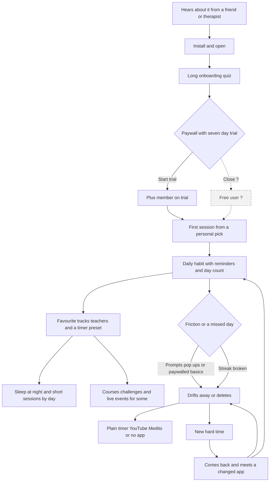

Every stage shown here is reported by a source. Only the free path after a closed paywall is inferred.

### Onboarding asks about 25 questions before any content

The capture shows **about 25 steps over roughly two and a half minutes**. The app asks who you are here for, up to three topics, your experience, interests, birth year, gender, today's mood, a days-in-a-row goal, minutes a day, time of day, a main goal and how you heard about it. It then shows a "projected results" graph and a 7-day trial explainer, followed by two paywall screens, **all before you create an account** ([ScreensDesign app page](https://screensdesign.com/apps/insight-timermeditate-sleep/)). A teardown notes that the flow opens with "a scientific argument for its own efficacy" and a personalised prediction "dated three months from sign-up, before showing any content" ([Appservatory](https://appservatory.com/case-studies/insight-timer/)). The trial is 7 days on the annual plan at US$59.99. The monthly plan at US$9.99 can only be chosen after the trial ([Help centre](https://insight-timer.freshdesk.com/support/solutions/articles/67000664699-how-do-i-cancel-before-my-free-trial-ends-on-ios-)).

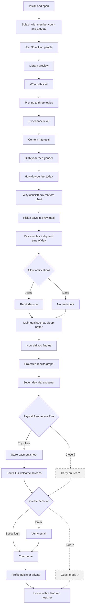

Guest Mode exists ([Help centre](https://insight-timer.freshdesk.com/support/solutions/67000385167)), but no source shows how a user who closes the paywall reaches it. Returning users report the quiz again: "Every time I open the app… it goes through the same 'Welcome back… let's get you set up' questions… 8 different screens" ([r/InsightTimer, 2025](https://reddit.com/r/InsightTimer/comments/1lclga5/)). Others report trial screens every time they start the timer ([r/InsightTimer, 2025](https://reddit.com/r/InsightTimer/comments/1lvixqf/)).

### The first session ends in a crowd of screens

Home leads with a personal pick, a featured teacher chosen from the onboarding answers. The player can add a sleep timer and layer ambient sound over a guided track. **Rewind, fast-forward, repeat and resume are paid features** ([Help: What is MemberPlus?](https://insight-timer.freshdesk.com/support/solutions/articles/67000664702-what-is-memberplus-)), so for a free user the player is play and pause. After the session come a mood slider and a journaling space ([ScreensDesign showcase](https://screensdesign.com/showcase/insight-timermeditate-sleep)), a "meditating with you" list of other users, and a milestone celebration if one has been reached ([Help: milestones](https://insight-timer.freshdesk.com/support/solutions/articles/67000698008-how-do-milestones-work-)). Users also report a screen asking them to "commit to meditating again tomorrow" ([r/InsightTimer, 2026](https://reddit.com/r/InsightTimer/comments/1rvme1e/)) and a "Discard session" button that is easy to hit by accident ([r/InsightTimer, 2025](https://reddit.com/r/InsightTimer/comments/1m5u5kd/)).

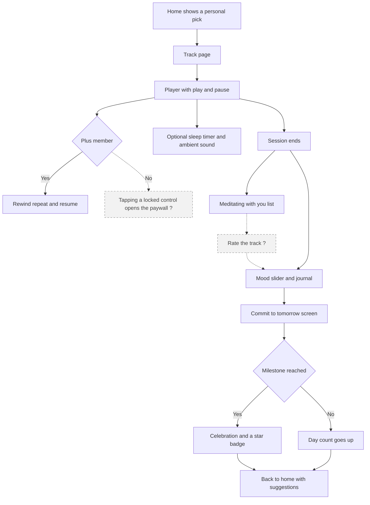

Each end screen is reported by a source, but no source gives their order, so treat the sequence as approximate.

### Habit formation runs on a day count, reminders and repair

The habit loop starts from the days-in-a-row goal set in onboarding. A home-screen day counter and widget show progress. **Streak Saver** sends a push when a streak is at risk ([Help: Streak Saver](https://insight-timer.freshdesk.com/support/solutions/articles/67000739886-how-do-i-disable-streak-saver-notifications-in-the-insight-timer-app-)). Milestones come at **7 days in a row or 50 days in total**, each adding a coloured star badge that others can see ([Help: milestones](https://insight-timer.freshdesk.com/support/solutions/articles/67000698008-how-do-milestones-work-)). Choosing which activities count toward the streak (sleep tracks, music, journal, check-ins) is a paid setting ([Help: customise stats](https://insight-timer.freshdesk.com/support/solutions/articles/67000714307-can-i-customize-my-stats-in-the-app-)). In late 2025 a **streak repair** prompt appeared that asks whether you practised yesterday, and it was received with gratitude: "I currently have a 415 day streak. I would have been heartbroken… when I didn't log in one day when I was sick" ([r/InsightTimer, 2025](https://www.reddit.com/r/InsightTimer/comments/1pd51je/_/ns4uenq/)).

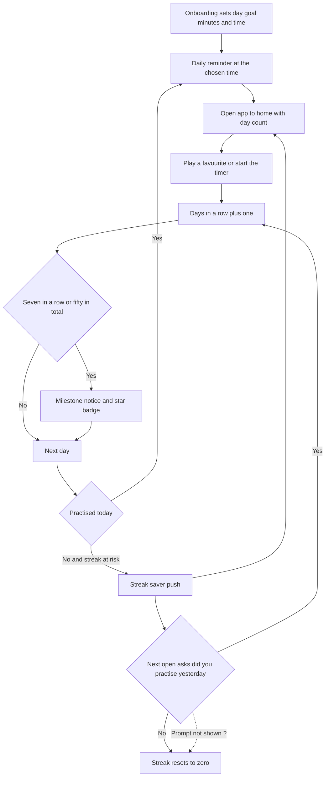

The repair prompt is verified from users' reports, including a complaint that it did not appear ("The app didn't ask me if I practiced yesterday and now I lost my streak!") ([r/InsightTimer, 2026](https://reddit.com/r/InsightTimer/comments/1wrpbog/)). No source says when it fires.

### Conversion is one hard push, then locks everywhere

MemberPlus is offered first and hardest at the end of onboarding. After that, the locks a free user meets are courses (MemberPlus-only since buying single courses was dropped) ([Help: buy a course](https://insight-timer.freshdesk.com/support/solutions/articles/67000664582-how-do-i-purchase-a-course-on-insight-timer-)), premium tracks, downloads, rewind and resume, the archive of past challenges, custom stats, the advanced journal and premium timer sounds. Cancellation happens in the app store, so there is no in-app cancel or save-offer screen. Users feel the locks in discovery too: "90% of it says 'plus'… I can't find a way to only search for free content" ([r/InsightTimer, 2025](https://reddit.com/r/InsightTimer/comments/1nhx6yy/)). Some users who report the timer button replaced by a Plus button may be seeing a bug or a test ([r/InsightTimer, 2026](https://reddit.com/r/InsightTimer/comments/1qq68f5/)).

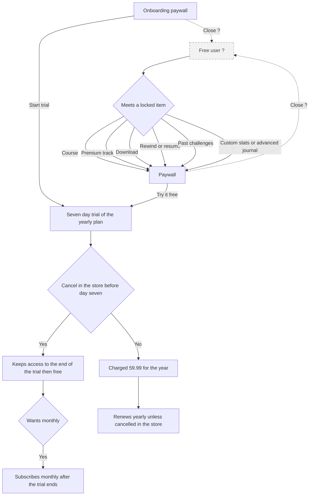

The list of locks is verified. No public capture shows an in-app lock screen after onboarding, so the "paywall" boxes there show the standard pattern rather than an observed screen.

### Sleep is a timer that stops the audio and locks the screen

Sleep is a content category (stories, music, nidra) plus a **Sleep Mode** that stops a track at its end or at a chosen time and then locks the screen. Sleep Mode does not work in courses ([Help: Sleep Mode](https://insight-timer.freshdesk.com/support/solutions/articles/67000742206-what-is-sleep-timer-and-how-does-it-work-)). A new sleep timer shipped in March 2026 and users welcomed it ([r/InsightTimer, 2026](https://reddit.com/r/InsightTimer/comments/1rkcqj6/)). The requests that remain are about repeat and continuous play: playlist repeat for all-night stories ([r/InsightTimer, 2025](https://reddit.com/r/InsightTimer/comments/1l135yy/playlists/)), and the opposite complaint of autoplay into the next track ([r/InsightTimer, 2025](https://www.reddit.com/r/InsightTimer/comments/1m2zado/_/n48w4m9/)).

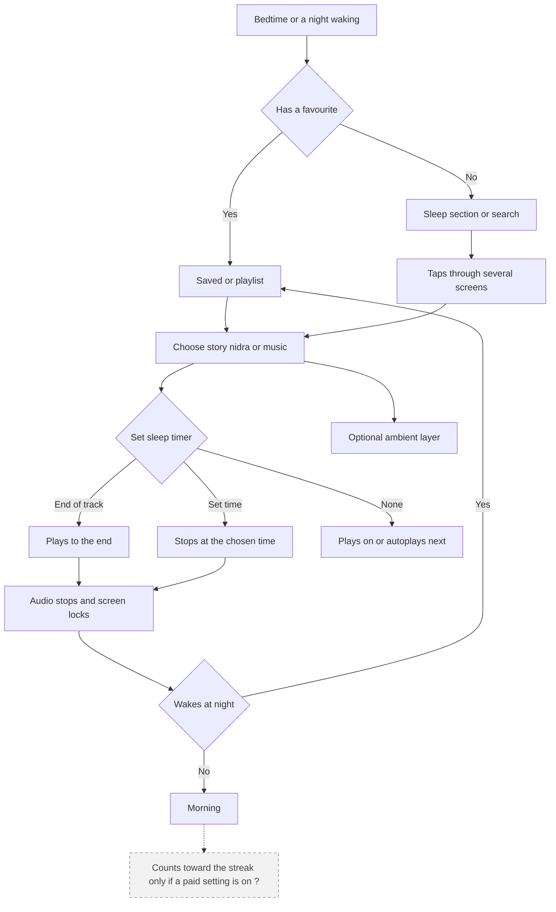

### Live events are a habit for a minority

Users find live events under What's On or on a teacher's page. Tapping **Attend** subscribes them to that teacher's sessions, and a push arrives 10 minutes before the start ([Help: live events](https://insight-timer.freshdesk.com/support/solutions/articles/67000665057-how-can-i-join-and-watch-live-events-on-insight-timer-)). Inside, there is a comment stream and a donate button at the top right ([Help: live rules](https://insight-timer.freshdesk.com/support/solutions/articles/67000664902-rules-and-guidelines-for-live-events)). The company says **about 10% of users take part**, and it keeps live mainly as a sales channel for courses and retreats ([Lou Redmond podcast, 2025](https://louredmond.com/podcast-1/2025/03/11/insight-timer-ceo-christopher-plowman-on-teacher-earnings-how-the-platform-is-changing)). For that minority it can be the reason to pay: "I join live yoga classes daily" ([r/InsightTimer, 2025](https://www.reddit.com/r/InsightTimer/comments/1kgsy8k/_/ms16fr1/)). A teacher reports that "only a small percentage of people actually use" the chat ([r/InsightTimer, 2025](https://reddit.com/r/InsightTimer/comments/1khpjda/)).

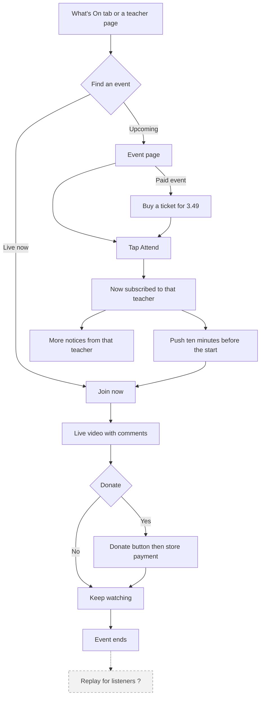

The $3.49 ticket appears in the App Store listing ([App Store](https://apps.apple.com/us/app/insight-timer-meditation-app/id337472899)). The help centre says replays are for teachers only but also carries a user-facing "How can I watch live event replays?" article, so whether listeners get replays is unresolved.

### Courses are the paid path, and the step after them is missing

A course has at least 3 lessons, usually 5–10, each 3–40 minutes. Students are encouraged to start at Lesson 1 and can ask questions in a classroom where teachers reply by audio ([Help: course requirements](https://insight-timer.freshdesk.com/support/solutions/articles/67000664708-instructions-and-requirements-for-courses)). Paying users name courses as the reason to subscribe ("The courses are worth it alone!") ([r/InsightTimer, 2026](https://www.reddit.com/r/InsightTimer/comments/1tolqtl/_/op20dxr/)). They also over-collect: one user has "22 folders with 263 courses… probably none" will be done ([r/InsightTimer, 2025](https://www.reddit.com/r/InsightTimer/comments/1iwyhza/_/mgxhcp0/)). Courses will not play continuously ([r/InsightTimer, 2026](https://www.reddit.com/r/InsightTimer/comments/1tolqtl/_/pbhik3o/)). After a course, beginners report nowhere to go next.

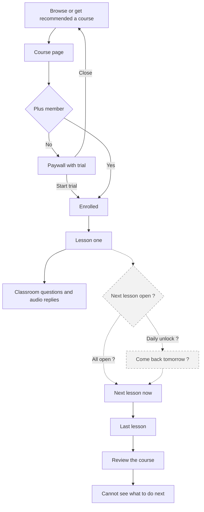

The help centre says lessons are "daily or sequential" but not which applies when. "Cannot see what to do next" is a user report, not a screen.

### Teachers climb a ladder that pays for next-day return

Becoming a teacher is free and non-exclusive. You upload a free track and wait up to five business days for review. **Two published free tracks unlock premium tracks, courses and live events**, and courses also need each free track to average 4.5 stars or more ([Help: course requirements](https://insight-timer.freshdesk.com/support/solutions/articles/67000664708-instructions-and-requirements-for-courses)). Teachers earn a play-weighted share of subscription revenue, and **25–30% of their income depends on "Return Rate"**: the share of listeners who come back the next day and do anything at all ([Teacher Income FAQ](https://insight-timer.freshdesk.com/support/solutions/articles/67000737721-teacher-income-faq-august-2024)). Discovery is hard on this side too: a teacher has "1,500+ followers, but barely any listeners… There are just so many teachers" ([r/InsightTimer, 2026](https://www.reddit.com/r/InsightTimer/comments/1xq9zzg/_/19saoj8eym0kg/)).

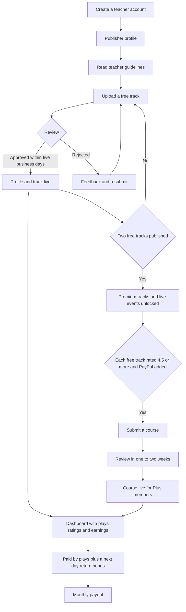

### Churn and return follow hard times, not campaigns

The verified re-engagement levers are all in-app notifications: the daily reminder, Streak Saver, milestone notices and teachers' live-event notices. No public record of win-back emails or lapsed-user discounts was found. What users report is a cycle. They delete the app over friction, then return when life gets hard: "I deleted it because of the aggressive check-in screens, returned after a few months, and finally deleted it… Now I'm going through another hard time and wishing the app still existed in its older form" ([r/InsightTimer, 2026](https://reddit.com/r/InsightTimer/comments/1w7ou4z/)). Returners often meet a changed app: "Just re downloaded insight timer after a few years. How did it get so schlocky?… It feels like temu now" ([r/InsightTimer, 2025](https://reddit.com/r/InsightTimer/comments/1kudi5k/)). Some lose their history on return through a sign-in mix-up that "over rode my previous account and I lost my favorites playlist" ([r/InsightTimer, 2025](https://reddit.com/r/InsightTimer/comments/1i0z6pk/)).

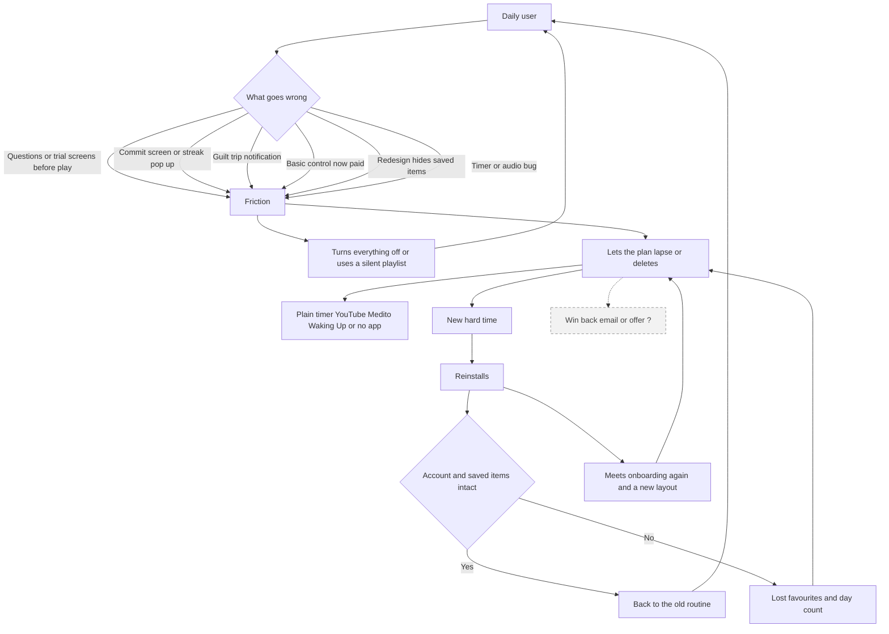

## People stay for history and leave over interruption

Insight Timer has never published a retention curve. The two figures most often quoted, "5x the retention of Calm" ([Koetsier, 2020](https://johnkoetsier.com/no-selling-allowed-how-insight-timer-is-building-the-biggest-meditation-community-on-the-planet/)) and "16% day-30 retention" ([StriveCloud](https://strivecloud.io/blog/user-retention-examples)), come with no method and should not be repeated. The CEO's own explanation is **self-selection**: about 70% of sign-ups in 2020 came by word of mouth, with $0 on paid search, and people who make an effort to find the app "tend to stick around" ([Koetsier, 2020](https://johnkoetsier.com/no-selling-allowed-how-insight-timer-is-building-the-biggest-meditation-community-on-the-planet/)). Independent data shows how hard the category is. In panel data across 93 mental-health apps, median **day-30 retention was 3.3%** ([Baumel et al., JMIR 2019](https://www.jmir.org/2019/9/E14567/)). Half of new Medito users spent **16 minutes or less in their whole first month**, and acute stress drove use while chronic stress disrupted it ([JMIR mHealth 2026](https://mhealth.jmir.org/2026/1/e79366)). Engagement tracked the app's appeal and its **perceived impact**, and no mental-health factor predicted it ([JMIR 2026](https://www.jmir.org/2026/1/e71960/PDF)). Combined sessions across the top 10 meditation apps fell 48% from the 2020 peak ([Apptopia](https://apptopia.com/blog/calm-and-headspace-losing-app-engagement/)). Converting people to paid is the easier part: health and fitness trials convert at a **median of 39.9%**, and across all app categories, trials of 17–32 days convert at 45.7% against 26.8% for trials of 4 days or less ([Athletech on RevenueCat 2025](https://athletechnews.com/?p=124212)).

Against that baseline, users describe four things that keep them. The first is **emotional history**: the app was there for a bereavement, an illness, insomnia or long COVID, and that bond survives months of non-use. The second is **accumulated state**: favourites, folders, a day count. Folder systems sorted by need ("sleep, gratitude, manifesting, morning") are common ([r/InsightTimer, 2026](https://www.reddit.com/r/InsightTimer/comments/1q7cljy/_/nyhiw04/)), and losing them feels like data loss. The third is **a handful of trusted voices**: "I always go back to Sarah Blondin, Davidji, and Tara Brach" ([r/InsightTimer, 2024](https://www.reddit.com/r/InsightTimer/comments/1fvu0l6/_/lwxq37a/)). The fourth is **a free library that feels ethical**, with no ads and no self-promotion, which is why users pick it over YouTube for yoga nidra ([r/yoganidra, 2026](https://www.reddit.com/r/yoganidra/comments/1wqchsy/_/pc5vwib/)). In the earlier review study, the top reasons in 1,430 five-star App Store reviews were "something for every mood" (310), "it's free" (308) and "it became a daily habit" (283) ([App Store reviews](https://apps.apple.com/us/app/id337472899?see-all=reviews)).

The leave triggers are concrete and nearly all self-inflicted. In the 2026 one- and two-star App Store reviews (168 in the sample), the themes were **prompts or questions before listening (65)**, a paywall on things that used to be free (50), being unable to find things (36) and streaks or "commit to 14 days" (27). These are keyword counts and show direction only ([App Store reviews](https://apps.apple.com/us/app/id337472899?see-all=reviews)). Reddit adds the texture. A 10-year member now uses it "almost never" because of the post-session commit screen: "The app should mind its own business" ([r/InsightTimer, 2026](https://reddit.com/r/InsightTimer/comments/1rvme1e/)). A night user let the subscription lapse over "tap, tap, tap, tap, tap" at 3am, after support explained that "people were split into different groups to trial different features" ([r/InsightTimer, 2025](https://reddit.com/r/InsightTimer/comments/1l9do0l/)). A notification titled "A Gentle Goodbye" felt "like a desperate girlfriend" ([r/InsightTimer, 2025](https://reddit.com/r/InsightTimer/comments/1lipc44/)). Autoplay video summaries drew a petition: "IT is not YouTube nor should it be" ([r/InsightTimer, 2026](https://reddit.com/r/InsightTimer/comments/1xexfbi/)). The subscription itself adds prompts: "when you subscribe there are MORE pop-ups trying to get you to engage" ([r/InsightTimer, 2026](https://www.reddit.com/r/InsightTimer/comments/1ticm8h/_/omtcpmp/)). Users route around all this. One keeps a **2,117-day run** going by putting guided tracks in a silenced playlist so that "No weird pop ups at the end" appear ([r/InsightTimer, 2025](https://www.reddit.com/r/InsightTimer/comments/1ly5248/_/n2y0yau/)). Others "turn everything off" in settings without reading it ([r/InsightTimer, 2026](https://www.reddit.com/r/InsightTimer/comments/1w7ou4z/_/p7xlhtd/)).

The same feature can keep one user and drive away another. **Streaks** are the clearest case. A user with ADHD celebrates "77 days! Longest habit of my life!" ([r/InsightTimer, 2025](https://reddit.com/r/InsightTimer/comments/1kzykbh/)). An 11-year subscriber calls it a "spiritual achievement competition" ([r/InsightTimer, 2025](https://www.reddit.com/r/InsightTimer/comments/1ly5248/_/n35a9ml/)), and another "cancelled my subscription due to this feature" ([r/InsightTimer, 2026](https://www.reddit.com/r/InsightTimer/comments/1s9z76u/_/phonhxc/)). The research agrees on both sides. Across seven studies, an intact streak raised continuation, but the effect was small (about **66% against 58%** after a break). The demotivation was worse when people blamed themselves and weaker when they could repair the streak ([Silverman & Barasch, JCR 2023](https://udspace.udel.edu/items/42ce576b-8e1f-429a-8541-e29e48dbcfbb); [Psychology Today summary](https://www.psychologytoday.com/us/blog/ulterior-motives/202306/how-broken-streaks-sap-motivation)). **Co-presence** splits users the same way, depending on its form. An anonymous count of people sitting at the same moment is loved ("thinking there are literally 1000s of ppl out there meditating too") ([r/InsightTimer, 2025](https://www.reddit.com/r/InsightTimer/comments/1inpm80/_/md3liia/)), and the removed world map is still missed ([r/InsightTimer, 2026](https://reddit.com/r/InsightTimer/comments/1tgmf7m/)). A feed with names and faces is resented ("Why do I have to see that Matt is listening…?") ([r/InsightTimer, 2025](https://reddit.com/r/InsightTimer/comments/1kgsy8k/)) and was one user's reason to uninstall after 17 years ([r/InsightTimer, 2026](https://reddit.com/r/InsightTimer/comments/1rvrurg/)). Open friend requests and messages mostly attract scammers ("99% are from men who have free accounts who are using bogus profile pics") ([r/InsightTimer, 2026](https://reddit.com/r/InsightTimer/comments/1t085py/)).

The other mechanics have thin but useful evidence. A tailored push made users **3.9% more likely** to engage in the next 24 hours, with a bigger effect at weekends ([Bidargaddi et al., JMIR mHealth 2018](https://mhealth.jmir.org/2018/11/e10123/)). Mood check-ins after a session in Calm were linked to meditating the following week, but the link **lasted only a week**, was **strongest among drifting subscribers**, and held for positive moods only. The study is observational and its authors are Calm-affiliated ([Huberty et al., JMIR mHealth 2021](https://www.ncbi.nlm.nih.gov/pmc/articles/PMC8105761/)). No study was found on teacher-following, daily-unlock courses, sleep content or recommendation engines as retention drivers. **Insight Timer's most distinctive retention device is paying its teachers on next-day return.** That device plausibly explains the multiplication of commit screens and prompts since 2024, though the company does not say so.

## First draft: twenty features Aurelia could take from Insight Timer

Aurelia turns one sentence about how someone feels into a guided session, delivered as five chapters with a daily check-in. In the current demo, the journey and check-ins live in the browser's own storage, sign-in deliberately does not persist, and there is no backend (`src/lib/journey.ts`, `src/lib/dailyCheckIn.ts`). Taking Eugene's brief to adopt what Insight Timer has, a first draft maps each Insight Timer feature to an Aurelia version.

| # | Insight Timer feature | Draft Aurelia version |
|---|---|---|
| 1 | Long personalising onboarding with a projected-results graph | A short quiz (goal, time of day, minutes, experience) and a "your next 5 chapters" forecast |
| 2 | Paywall with a 7-day annual trial at the end of onboarding | Trial offer right after onboarding, before the first session |
| 3 | Days-in-a-row goal, day counter, star badges | A chapter streak and badges at 7 and 50 days |
| 4 | Streak Saver push | A reminder when the streak is at risk |
| 5 | Daily reminder at a chosen time | A daily reminder for the next chapter |
| 6 | Mood slider and journal after a session | The daily check-in after each chapter |
| 7 | "Meditating with you" list and map | "1,200 people did a chapter tonight" |
| 8 | Silent timer with bells | An unguided timer mode |
| 9 | Sleep Mode, sleep timer, ambient layering | Sleep chapters with a stop timer and background sound |
| 10 | Bookmarks, folders, playlists | A library of your own sessions |
| 11 | Courses with a classroom | Chapters as a course, with questions answered by AI |
| 12 | The January 31-day challenge | A seasonal challenge |
| 13 | Live events with donations | Live group sessions |
| 14 | Teacher marketplace and Return Rate pay | Human creators supplying voices and scripts |
| 15 | Star ratings on tracks | Rate every session |
| 16 | Therapist Hub | Therapists share sessions with clients |
| 17 | Resolution and daily intention on Home | An intention line on Home |
| 18 | Groups, friends and messages | A community space |
| 19 | Donations to teachers | Tip jar |
| 20 | Guest Mode and session export | Start without an account; export your history |

## The roast: a sceptical reviewer takes the draft apart

**"You are copying the survivors."** Almost every reason to believe these features work comes from people who stayed: long-tenure Reddit posters, five-star reviewers, the CEO's 300,000 daily timer users out of 18 million sign-ups. Insight Timer's own explanation for its retention is word-of-mouth self-selection, not any feature ([Koetsier, 2020](https://johnkoetsier.com/no-selling-allowed-how-insight-timer-is-building-the-biggest-meditation-community-on-the-planet/)). The millions who installed and vanished left no posts. A list of features that loyal users mention is a list of what loyal users touch, not what made them loyal. Aurelia will acquire through paid or cold channels, so Insight Timer's curve is not on offer, and the honest planning baseline is a day-30 figure of about 3–5% ([Baumel et al., 2019](https://www.jmir.org/2019/9/E14567/)).

**"Items 1 and 2 copy the single most hated thing in the app."** Questions before listening are the largest complaint theme in 2026. A 25-step quiz in front of Aurelia's one-sentence promise breaks the promise: the sentence *is* the personalisation. A paywall before the first session asks people to pay before Aurelia has proved anything, when Aurelia's only defensible claim is "proven on you". It also cannot be built honestly today: with no backend, no accounts that persist and no payment processing, a trial would be a mock-up with a countdown attached. Copying the projected-results graph is worse still. It shows a forecast of improvement before any data exists, which is the invented-progress problem Aurelia already removed from its own player (`src/lib/journey.ts` records that the demo once showed "+3% since yesterday" before the first listen).

**"Aurelia's own daily check-in already repeats Insight Timer's mistake."** In the demo, the check-in sheet opens on every sign-in, even when today is answered, by the owner's instruction for demo purposes (`src/lib/dailyCheckIn.ts`). That is exactly the "every time I open the app…" pattern that drives Insight Timer's angriest reviews. The Calm evidence also says a check-in is a one-week nudge that works for good moods. A negative check-in is not a retention lever but a moment that needs care, and Aurelia still has no crisis link in the consumer app.

**"Streaks, Streak Saver and badges (3, 4) buy a small effect at a large trust cost."** The effect is about eight percentage points in a lab ([Psychology Today](https://www.psychologytoday.com/us/blog/ulterior-motives/202306/how-broken-streaks-sap-motivation)), and the backlash includes cancellations. Aurelia also has a fragility Insight Timer does not: the journey lives in one browser, so clearing site data or switching phones resets the count, the same 78-to-0 loss that Insight Timer users mourn ([r/InsightTimer, 2025](https://reddit.com/r/InsightTimer/comments/1oqnwau/)). A five-chapter journey already supplies structure, so a streak on top is a second scoreboard. And a web app without a backend cannot send a Streak Saver push at all; the demo's reminder is a calendar file.

**"Item 7 would be a fabricated number."** Aurelia's catalogue is mock data designed to look real. With no backend there is no count of people doing anything. "1,200 people did a chapter tonight" would be invented social proof in a wellness product, the one place where a discovered fake costs everything. Even with real data, the only tested form people like is an anonymous count, and there is no study showing it lifts engagement.

**"Items 11–14 and 18–19 build a second company."** Live events reach about 10% of Insight Timer users and are expensive enough that the company keeps them as a sales channel ([Lou Redmond podcast](https://louredmond.com/podcast-1/2025/03/11/insight-timer-ceo-christopher-plowman-on-teacher-earnings-how-the-platform-is-changing)). A teacher marketplace needs payouts, moderation and review queues, and Insight Timer's supply side is itself in distress ("I only make around $10/month") ([r/InsightTimer, 2025](https://reddit.com/r/InsightTimer/comments/1k6retu/)). Groups, friends and messages attract scammers. Donations need people to tip, which Aurelia does not have. None of these uses what is different about Aurelia, and all of them need a backend.

**"Star ratings (15) are noise."** Users say everything sits at 4.7–4.8 because "people give good ratings because they want to be nice" ([r/InsightTimer, 2026](https://reddit.com/r/InsightTimer/comments/1xexfbi/)), and many rate only what they like. For a session made for one person, a public rating means nothing. What matters is whether it helped, which the check-in already asks.

**"Optimising for next-day return is how Insight Timer got its pop-ups."** The Return Rate idea is attractive because Aurelia can score its generator on it directly, without a teacher payroll. But a single return metric rewards nagging. Insight Timer's commit screens and intention prompts are what that metric looks like when product teams chase it.

**"The draft ignores the job people actually hire it for."** Sleep is the largest job in users' words, and its failure modes are mechanical: audio that stops on a locked screen, taps at 1am, sounds that wake you. Aurelia is a web app today. Keeping audio playing on a locked phone, in a browser, through a whole night, is a hard engineering problem, not a content one. A sleep promise that fails at 2am will do more damage than having no sleep feature. The same 1am user also rules out "type a sentence" as the only way in. Someone half-asleep needs "same as last night" in one tap.

**"It copies the menu, not the unmet need."** The most specific thing Insight Timer users ask for and cannot get is control over the *guidance itself*: less talk over time, pauses, skipping the intro, a predictable end bell, a no-visualisation version, no music, a calmer voice. A library cannot deliver this without someone recording every variant. Aurelia's modular changes can. The draft buries this under a "timer mode" and a "library".

**"Price and trust are missing."** Aurelia's planned US$100 a year sits 67% above Insight Timer's US$59.99, and Insight Timer markets "No AI" as a virtue. An AI product that copies Insight Timer's engagement layer gets the worst of both: the nagging people already hate plus the suspicion people already feel about AI.

## What survives: the final recommendations, now, next and later

The recommendations that survive share one principle: **adopt what makes the quiet path faster and more personal, and drop what adds steps to it.** "Now" means it can be built or decided in the current demo without a backend. "Next" needs accounts and a backend. "Later" needs real users and data.

### Now: rules and small builds the demo can carry

| What to adopt | How it fits Aurelia's sessions and chapters | Evidence |
|---|---|---|
| **Nothing between the sentence and the first play** | The sentence is the onboarding. Ask goal, reminder time or wearable only after the first session, and only once. Never re-run onboarding for a returning person. | Prompts before listening were the top complaint theme (65 of 168) ([App Store reviews](https://apps.apple.com/us/app/id337472899?see-all=reviews)); "8 different screens" for returners ([r/InsightTimer](https://reddit.com/r/InsightTimer/comments/1lclga5/)) |
| **Check-in after the chapter, at most once a day, skippable in one tap** | Keep "How do you feel now?" after the session and show the answer back in words, as v5's progress-in-words does. Before real users, change the demo's every-sign-in sheet to once a day. | Calm check-ins linked to next-week practice for a week only ([Huberty et al.](https://www.ncbi.nlm.nih.gov/pmc/articles/PMC8105761/)); perceived impact drives engagement ([JMIR 2026](https://www.jmir.org/2026/1/e71960/PDF)); "Why keep asking 'How are you feeling'?" ([r/InsightTimer](https://reddit.com/r/InsightTimer/comments/1g4a0d9/)) |
| **A low check-in gets care, not a nudge** | A "feeling awful" answer offers a gentler next chapter and a visible "Need help now?" link, never a commitment prompt. | Crisis is a core job ([r/Anxiety](https://reddit.com/r/Anxiety/comments/10rcczt/)); negative check-ins showed no retention link ([Huberty et al.](https://www.ncbi.nlm.nih.gov/pmc/articles/PMC8105761/)) |
| **Guidance controls as modular changes** | Offer "less talking", "longer pauses", "skip the intro", "end with a bell", "no visualising", "no music" and voice pace as changes to a session, and remember them for the next chapter. This is the one feature Aurelia can do better than any library. | The most specific unmet need in the sample ([r/InsightTimer](https://reddit.com/r/InsightTimer/comments/1uqke2i/); [r/InsightTimer](https://reddit.com/r/InsightTimer/comments/1obhw09/); [r/InsightTimer](https://www.reddit.com/r/InsightTimer/comments/1iwyhza/_/mej79wm/)) |
| **"Same as last night" in one tap** | Home offers the last session, and favourites, before the text box. A chapter can be replayed as often as wanted. | Users rotate 3–5 favourites ([r/yoganidra](https://www.reddit.com/r/yoganidra/comments/1opx1mh/_/nnfwe5y/)); "85 clicks" ([r/InsightTimer](https://www.reddit.com/r/InsightTimer/comments/1kgsy8k/_/mr6l3br/)); "1am is not a time to search" ([r/InsightTimer](https://www.reddit.com/r/InsightTimer/comments/1i9w3ed/_/m9mjfos/)) |
| **Consistency that forgives** | Show "4 of the last 7 days" or chapters done, inside Progress only, with no reset, no pop-up and no badge. If a count is ever shown, ask "did you practise yesterday?" before it drops. | Streak effects are small and worse with self-blame ([Silverman & Barasch](https://udspace.udel.edu/items/42ce576b-8e1f-429a-8541-e29e48dbcfbb)); repair was welcomed ([r/InsightTimer](https://www.reddit.com/r/InsightTimer/comments/1pd51je/_/ns4uenq/)); "celebrate consistency over a certain period" ([r/InsightTimer](https://reddit.com/r/InsightTimer/comments/1s9z76u/)) |
| **One reminder, set by the person, in plain words** | Keep the calendar reminder for the next chapter. One message at the chosen time, never guilt, never "goodbye". | A push gives about a 4% next-day lift ([Bidargaddi et al.](https://mhealth.jmir.org/2018/11/e10123/)); "Gentle Goodbye" backlash ([r/InsightTimer](https://reddit.com/r/InsightTimer/comments/1lipc44/)) |
| **Write the fair-paywall rule down now** | Never charge for rewind, resume, replaying your own sessions, your history or your export. Charge for making new sessions and journeys. | Paywalled basics were the second complaint theme (50 of 168) ([App Store reviews](https://apps.apple.com/us/app/id337472899?see-all=reviews)); "premium pop up" when rewinding ([r/InsightTimer](https://reddit.com/r/InsightTimer/comments/1t0ahi2/)) |
| **Start without an account** | Keep the guest-first start; the free limit counts only after the first build. | Guest Mode exists ([Help centre](https://insight-timer.freshdesk.com/support/solutions/67000385167)); Medito's no-sign-up model is where paywall leavers go ([r/InsightTimer](https://www.reddit.com/r/InsightTimer/comments/1tthab7/_/op2qasz/)) |

### Next: what needs accounts and a backend

| What to adopt | How it fits Aurelia | Evidence |
|---|---|---|
| **Saved sessions and history that never vanish, plus export** | Accounts that keep every session, chapter, check-in and favourite, across devices. Export as a file. Never move saved items in a redesign without a notice. | Account loss and moved bookmarks drive anger and exits ([r/InsightTimer](https://reddit.com/r/InsightTimer/comments/1i0z6pk/); [MWM](https://mwm.ai/articles/app-updates/insight-timer-v20-17-0-buries-saved-meditations-in-bloated-redesign-may-2026)); CSV export is the leaver's last comfort ([r/InsightTimer](https://www.reddit.com/r/InsightTimer/comments/1ticm8h/_/omtg6yj/)) |
| **A sleep mode built for a locked phone** | Sleep chapters that fade and stop at the end or at a chosen time, an all-night option, no sudden sounds. Test it on real iPhones and Android phones overnight before calling Aurelia a sleep product. | Sleep is the largest job in users' words; audio stopping on lock is a leave trigger ([r/InsightTimer](https://reddit.com/r/InsightTimer/comments/1xod5o8/)); sound sensitivity ([r/InsightTimer](https://reddit.com/r/InsightTimer/comments/1tblnwo/sleep_music/)) |
| **A trial that covers a whole journey, offered after chapter one** | Ask for payment after the first chapter has been felt, offer a trial long enough to finish five chapters, show the trial timeline with a reminder before the charge, and explain how to cancel. | Across app categories, trials of 17–32 days convert at 45.7% against 26.8% for short ones ([RevenueCat via Athletech](https://athletechnews.com/?p=124212)); in 2020 Insight Timer sent four emails warning of the trial charge ([Koetsier](https://johnkoetsier.com/no-selling-allowed-how-insight-timer-is-building-the-biggest-meditation-community-on-the-planet/)) |
| **Score the generator on "came back and said it helped"** | Borrow the Return Rate idea, but pair next-day return with the check-in's "did it help?" so that nagging cannot win. | Return Rate pay design ([Teacher Income FAQ](https://insight-timer.freshdesk.com/support/solutions/articles/67000737721-teacher-income-faq-august-2024)); the prompt backlash it plausibly produced |
| **Share a session with a therapist or client** | A link or QR code that plays one session, free, with no sign-up wall. | Therapists recommend specific free tracks ([Trustpilot](https://www.trustpilot.com/review/www.insighttimer.com?page=3)); one stopped because the app felt "salesy" ([r/InsightTimer](https://reddit.com/r/InsightTimer/comments/1kl5f8v/)) |
| **An unguided ending and a bell** | Let a chapter end in timed silence with interval bells, so practised users can grow toward less guidance inside the journey. | The timer is the habit core for a committed minority ([Koetsier](https://johnkoetsier.com/no-selling-allowed-how-insight-timer-is-building-the-biggest-meditation-community-on-the-planet/)); "an app as training wheels" leavers ([r/InsightTimer](https://www.reddit.com/r/InsightTimer/comments/1tthab7/_/optkfne/)) |
| **A next step after chapter five** | When a journey ends, offer one continuation built from the check-ins, never a menu of courses. | Beginners stall after the 7-day course ([r/InsightTimer](https://reddit.com/r/InsightTimer/comments/1k9qy5w/)); over-collected courses go unused ([r/InsightTimer](https://www.reddit.com/r/InsightTimer/comments/1iwyhza/_/mgxhcp0/)) |

### Later: only with real users and real data

| What to consider | Condition | Evidence |
|---|---|---|
| **An anonymous "others tonight" count** | Only from real counts, never names or faces, with an off switch, and run as an experiment. | The count and map are loved, faces resented ([r/InsightTimer](https://reddit.com/r/InsightTimer/comments/1tgmf7m/); [r/InsightTimer](https://reddit.com/r/InsightTimer/comments/1kgsy8k/)); no engagement study exists |
| **One shared seasonal journey** | A January theme where everyone's chapters are personal but the topic is shared. Plan for the drop after the January spike. | The January challenge drives discovery ([r/InsightTimer](https://www.reddit.com/r/InsightTimer/comments/1fvu0l6/_/lqakyw7/)); Headspace's January actives decayed about 15% within the quarter ([Sensor Tower](https://sensortower.com/blog/2024-q1-unified-top-5-wellness%20apps-revenue-us-63e274e1e1714cfff10eaa2f)) |
| **Licensed human voices** | If users want a known voice, license a few and disclose clearly which parts are AI-made. Do not build a marketplace. | Loyalty attaches to voices ([r/yoganidra](https://www.reddit.com/r/yoganidra/comments/1nie0sh/_/nejztz8/)); leavers follow teachers off-platform ([r/InsightTimer](https://www.reddit.com/r/InsightTimer/comments/1ly5248/_/onavtaz/)) |
| **Live sessions** | Probably never. Revisit only if Aurelia gains a human-led layer. | About 10% take part, and it is costly ([Lou Redmond podcast](https://louredmond.com/podcast-1/2025/03/11/insight-timer-ceo-christopher-plowman-on-teacher-earnings-how-the-platform-is-changing)) |

### What to avoid outright

The things to leave out are as specific as the things to copy. Each one below is a documented leave trigger at Insight Timer, and most would hurt Aurelia more because Aurelia has less goodwill to spend. Do not put a questionnaire, a forecast graph or a paywall before the first session. Do not show a "commit to tomorrow" or "discard session" screen after a session. Do not let a streak reset to zero, and do not celebrate days in a row with pop-ups or public badges. Do not send notifications that guilt, threaten or say goodbye. Do not autoplay video or animate the screen after a calm session. Do not open friend requests or direct messages. Do not add public star ratings. Do not put basic playback, history or export behind the paywall. Do not re-run onboarding for people who come back. Do not move saved items in a redesign without warning. Do not split people into experiments on the core open-to-play path without telling them. And never show an invented number of other users, invented progress or an invented forecast while the data is mock.

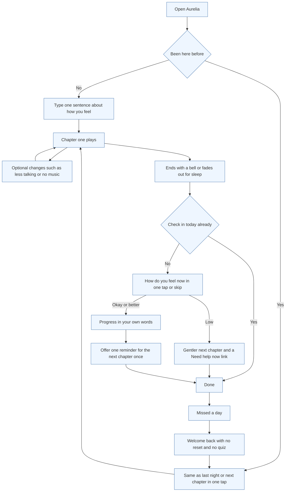

This last chart is a **proposal** for Aurelia, not a record of either app. It is drawn in blue to keep it apart from the verified and inferred Insight Timer flows above.

## Conclusion

The most useful thing Insight Timer shows Aurelia is not a feature but a split. One part of its product delivers the help people came for: the right track or timer, played at once, the same way tonight as last night. The other part exists to bring people back tomorrow: questionnaires, commit screens, streak alarms, social feeds and paywall screens. Users love the first part and are leaving over the second. Aurelia's advantage is that its core can replace the hunting that keeps people in Insight Timer's menus. The guide can talk less as someone learns, leave room for silence, drop visualisation, end on a bell and fit the minutes available, without anyone recording every version. Copying the engagement layer would throw that advantage away and add the suspicion people already feel toward AI.

The honest limit is evidence. Nothing here proves that any feature retains people, and Insight Timer's loyal users are survivors of a word-of-mouth funnel Aurelia will not have. The test that matters comes next, with real users: for one narrow group, such as people whose mind races at night, measure whether a chapter with no screens before it, an optional check-in after it and guidance shaped by the check-ins brings them back the next night and leaves them saying it helped. Until that number exists, the right stance toward Eugene's goal of adopting what Insight Timer has is to adopt its quietest habits first and to treat everything louder as an experiment that has to earn its place.
