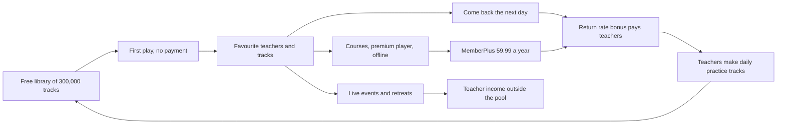
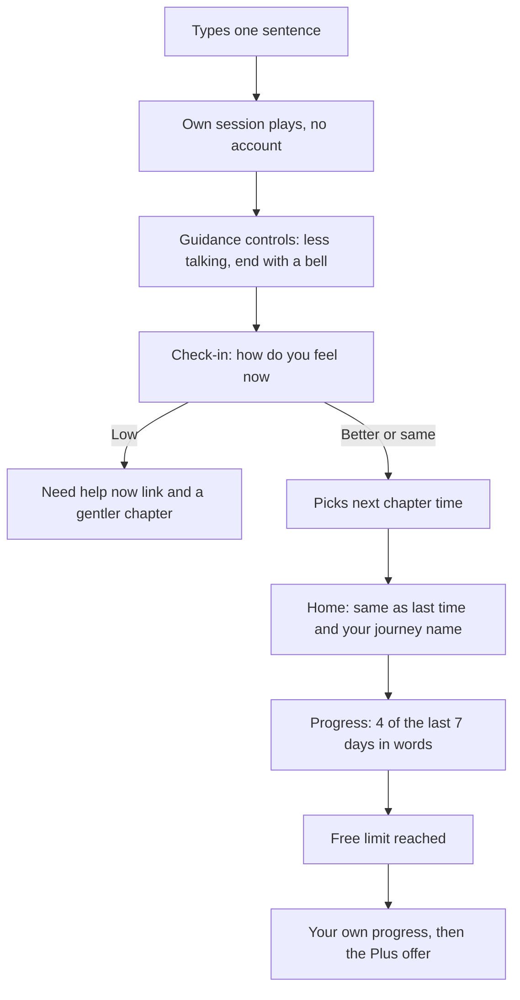
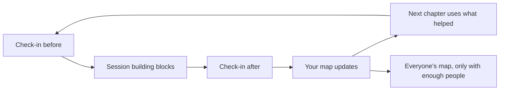
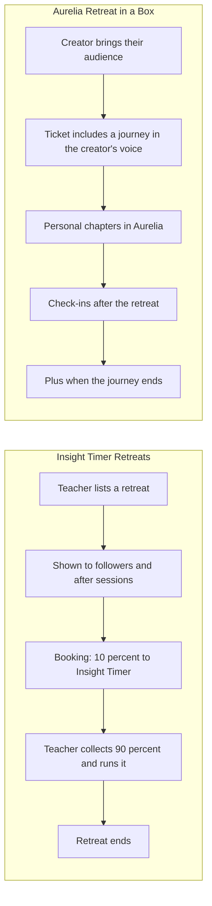

# Insight Timer round 3: quick wins and the healing map

## In one minute

- **Insight Timer's scale is a big free library on top of a much smaller active core.** The company says 35 million users ([India launch, Mar 2026](https://theprint.in/ani-press-releases/worlds-largest-free-wellness-app-insight-timer-launches-in-india/2875253)), but its own App Store page says **3 million monthly active members** ([App Store, 25 Nov 2026](https://apps.apple.com/us/app/insight-timer-meditate-sleep/id337472899)). That is about 1 in 12 (our estimate from two company figures). The quick wins come from what keeps that core, not from the headline number.
- **The engine is pay for next-day return.** 25–30% of all teacher income goes to a "return rate" fund that rewards tracks whose listeners come back the next day ([help centre](https://insight-timer.freshdesk.com/support/solutions/articles/67000748946-understanding-return-rates)). That explains both the loyalty and the pop-ups people complain about.
- **Ten quick wins fit Aurelia's frontend-only app now.** The top five: your first session before any account, guidance controls ("less talking", "longer silence", "end with a bell"), the check-in that sets the next chapter's time, a "Need help now?" link after a low check-in, and one-tap "same as last time". Each is adapted to "one sentence → a session made for you", not copied.
- **Their Map of Healing counts research links. Ours would learn from results.** Theirs says 933 practices, 75 mechanisms, 340 body changes and 131 conditions from 250,000 papers (company claim), and states that "every link is a count of documented connections, never a claim of evidence strength" ([Map of Healing](https://insighttimer.com/science)). Ours can only show sample data, clearly labelled, until real check-ins exist.
- **Their Retreats product is a listing service with a 10% booking fee.** The teacher does everything else ([retreat FAQ](https://insight-timer.freshdesk.com/support/solutions/articles/67000739470-insight-timer-retreats-faqs-for-teachers)). Nothing we found shows a retreat continuing in the app afterwards. That "after" is exactly what Retreat-in-a-Box sells.

This round builds on round 1 (features and business, `?v=1`) and round 2 (behaviour and journeys, `?v=2`). It adds 2026 facts on creators, retreats, the Map of Healing, pricing and reviews, and reads all of it through the Product lab: the business funnel's five stages (entry, aha, cap, upsell, stay), the user journey's moments, and the buyer agent runs. Research was done on 25 November 2026. Every fact carries a link and one of four labels: **measured** (a count anyone can repeat), **company claim**, **third-party**, or **estimate** (ours).

## 1. What drives retention and conversion now

| Driver | What it is in late 2026 | Label and source |
|---|---|---|
| Free library depth | 300,000+ tracks in March 2026; a release on 24 Nov 2026 added about 925 free meditations and 476 sleep tracks in one version | Company claim ([India launch](https://theprint.in/ani-press-releases/worlds-largest-free-wellness-app-insight-timer-launches-in-india/2875253); [App Store](https://apps.apple.com/us/app/insight-timer-meditate-sleep/id337472899)) |
| Scale | 30M users on the home page, 32M in January, 35M in March; 3M monthly active on the App Store | Company claims ([home](https://insighttimer.com/en-au); [App Store](https://apps.apple.com/us/app/insight-timer-meditate-sleep/id337472899)) |
| Teachers | More than 20,000 | Company claim ([India launch](https://theprint.in/ani-press-releases/worlds-largest-free-wellness-app-insight-timer-launches-in-india/2875253)) |
| MemberPlus | $59.99 a year or $9.99 a month; Family $89.99. Includes courses, premium tracks, video, the advanced player (repeat, rewind, resume), past challenges, folders, personalised milestones, an advanced journal and offline downloads | Company ([help centre](https://insight-timer.freshdesk.com/support/solutions/articles/67000664702-what-is-memberplus-); [App Store](https://apps.apple.com/us/app/insight-timer-meditate-sleep/id337472899)) |
| Regional pricing | India store: Premium at ₹249, ₹1,499 and ₹4,899 (periods not labelled), Family ₹1,999. "Prices and currency vary by location" | Measured on the store page ([App Store India](https://apps.apple.com/in/app/id337472899)) |
| Courses | Members only; teachers earn per lesson played | Company ([earnings](https://insight-timer.freshdesk.com/support/solutions/articles/67000664874-how-can-teachers-earn-revenue-from-their-work-)) |
| Live events | A "What's On" tab; donations, and paid tickets at $13.99 (US) | Company ([live events](https://insight-timer.freshdesk.com/support/solutions/articles/67000754308-what-are-live-events-); [App Store](https://apps.apple.com/us/app/insight-timer-meditate-sleep/id337472899)) |
| Retreats | Listed by teachers; 10% booking fee; minimum $200 multi-day, $100 one-day | Company ([retreat FAQ](https://insight-timer.freshdesk.com/support/solutions/articles/67000739470-insight-timer-retreats-faqs-for-teachers)) |
| Check-ins, milestones, journal | Count as a "return" for teacher pay; "progress milestones" listed as a feature | Company ([return rates](https://insight-timer.freshdesk.com/support/solutions/articles/67000748946-understanding-return-rates); [App Store](https://apps.apple.com/us/app/insight-timer-meditate-sleep/id337472899)) |
| AI | January 2026: intention-setting with an "AI recommendation engine", the person's intention on the home screen all year; Reflect, an AI conversation partner that does not diagnose. Content itself stays human-made | Company ([release](https://www.globenewswire.com/news-release/2026/01/06/3213643/0/en/insight-timer-launches-new-year-s-resolution-and-intention-setting-features-with-ai-recommendation-engine.html); [AI safety](https://insighttimer.com/ai-safety)) |
| Ratings | US App Store 4.9 from 450K ratings; India 4.8 from 5.5K; Trustpilot 4.2 from 167 reviews | Measured on the pages ([App Store](https://apps.apple.com/us/app/insight-timer-meditate-sleep/id337472899); [India](https://apps.apple.com/in/app/id337472899); [Trustpilot](https://www.trustpilot.com/review/www.insighttimer.com)) |

**Review themes in 2026** (third-party, Trustpilot, dated): praise for the free tier ("an incredible amount of value", July and September), people using it daily for 10–15 years (May, July), a practitioner who sends clients specific free tracks (24 October), and one reviewer who likes that it "rejects artificial retention hacking and dark patterns" (May). Against: "10 popups each time" I open it (29 September), a dropped yearly pass and confusing trial terms (June, July), AI-made tracks left up for weeks after being reported (17 July), and clunky filters for people with poor eyesight (May) ([Trustpilot](https://www.trustpilot.com/review/www.insighttimer.com)). These match round 2's 168 App Store reviews, where prompts before listening (65) and paywalled basics (50) led the complaints.

**What we read from this.** The store rating stays at 4.9 because the satisfied core rates in the app. The anger concentrates on interruptions and changed terms. The engine pays creators for next-day return, and the company's own tip to teachers is "create tracks for daily practice" ([return rates](https://insight-timer.freshdesk.com/support/solutions/articles/67000748946-understanding-return-rates)). A competitor-written critique quotes the CEO in 2025: "We needed people to come back to our platform more frequently" (third-party, author runs a rival app; [Mindful Leader, 17 Nov 2026](https://www.mindfulleader.org/blog/125585-is-insight-timer-one-of-the-good-guys)).

## 2. The creator programme in depth

| How a teacher earns | Rule | Label and source |
|---|---|---|
| Share of MemberPlus | By plays and content type; premium weighted above free; courses and video count; no percentage published. A play counts after 120 seconds | Company ([earnings](https://insight-timer.freshdesk.com/support/solutions/articles/67000664874-how-can-teachers-earn-revenue-from-their-work-)) |
| Return rate bonus | 25–30% of all teacher income; tracks above their category average for next-day return earn a bonus; categories Guided, Sleep, Music, Kids, Non-English; free and paid judged apart | Company ([return rates](https://insight-timer.freshdesk.com/support/solutions/articles/67000748946-understanding-return-rates)) |
| Donations | The teacher keeps 100%; Apple takes 30% on iPhone | Company ([earnings](https://insight-timer.freshdesk.com/support/solutions/articles/67000664874-how-can-teachers-earn-revenue-from-their-work-)) |
| Live events | Donations and paid tickets; used to promote tracks, courses and retreats | Company ([live events](https://insight-timer.freshdesk.com/support/solutions/articles/67000754308-what-are-live-events-)) |
| Retreats | Insight Timer keeps a non-refundable 10% deposit; the teacher collects 90% directly | Company ([retreat FAQ](https://insight-timer.freshdesk.com/support/solutions/articles/67000739470-insight-timer-retreats-faqs-for-teachers)) |
| Payout | Monthly on the 21st through Tipalti, once $10 is reached; unclaimed after 12 months goes to charity | Company ([earnings](https://insight-timer.freshdesk.com/support/solutions/articles/67000664874-how-can-teachers-earn-revenue-from-their-work-)) |
| "About 50% of subscription revenue to creators" | Repeated on third-party sites, not on any company page | Third-party, unconfirmed ([Starter Story](https://www.starterstory.com/businesses/insight-timer/monetization)) |

The lesson for Aurelia is that **the free library is paid for by the creators' own audiences and a pooled subscription**, and that creators are steered by what the pool rewards. Aurelia's creators would bring audiences through retreats and journeys, not through a library, so the reward has to be designed with the same care. Rewarding return alone is how a platform ends up with pop-ups. Rewarding return *and* "it helped" is the version worth copying.

## 3. Insight Timer's features on Aurelia's funnel and journey

The business funnel has five stages: **entry** (frictionless start), **aha** (one sentence becomes their own session and they feel better), **cap** (the free limit), **upsell** (Aurelia Plus) and **stay** (coming back as things improve). The user journey has moments in four stages: Reflect, Create, Experience and Share.

| Insight Timer feature | Funnel stage | Journey moment | Aurelia today | Gap |
|---|---|---|---|---|
| Free play with guest mode | Entry | Before sleep; before an event | Quick Start plays before sign-in; your own session needs an account | Your own first session without an account (a proposed decision) |
| 25-question onboarding, then a paywall | Entry | (none) | One sentence plus a few onboarding steps | Keep it short; ask the wearable after the first session |
| Search by feeling, then the first fitting track | Aha | In-the-moment conversation | The sentence builds a session | Aurelia is ahead here |
| Voice, pacing, "minimally guided" filters | Aha | Every Experience moment | Changes exist, but not guidance controls | Add guidance controls as changes |
| Sleep timer, fade-out, all-night audio | Aha, stay | Before sleep | A player with no sleep mode | Sleep mode |
| Mood check-in and journal | Aha, stay | Morning check-in | Check-in after a chapter, progress in words, a journal | Tie the next chapter's time to the check-in |
| Crisis notice and help lines | Aha (safety) | After an event | Not in the player | "Need help now?" after a low check-in |
| Day count, milestones, streak pop-ups | Stay | Celebrate progress | No streaks (a standing rule) | "4 of the last 7 days" inside Progress only |
| Bookmarks, favourites, "same 5 tracks" | Stay | Morning; commuting | Library of Created and Played | One tap "same as last time" on Home |
| Offline downloads (paid) | Stay | Commuting | The whole demo works offline after one visit | Say so; keep one offline session free when real |
| Intention on the home screen all year | Stay | Morning | The journey's next chapter leads Home | Show the person's own sentence as the journey's name |
| Premium player (rewind, resume) behind the paywall | Upsell | (none) | Nothing can be bought yet | Write down: basics are never paid |
| Seven-day trial on the yearly plan, monthly later | Upsell | (none) | Upgrade screen, $10 a month or $100 a year | Yearly first; a trial long enough for a journey |
| Regional prices | Upsell | (none) | One price | Show local prices (a proposed decision) |
| Courses for members | Cap, upsell | Before sleep; morning | Five-chapter journeys | Aurelia's journeys are the course, made for you |
| Live events | Stay | (none) | None | Do not build |
| Teacher follows and groups | Stay | Share | Community without ranks (v5) | Keep small |
| Share a track, embeddable player | Entry (reach) | Celebrate progress | Share sheet in the player | A free play link with no sign-up wall |
| Retreats marketplace | Entry (reach), upsell | Share | Retreat funnel in the admin | Retreat-in-a-Box continues after the retreat |
| Map of Healing | Aha (trust) | (none) | Living Intelligence tiles (design) | A personal map from your own check-ins, sample until real |
| Return rate pay | Stay (creators) | (none) | Not applicable yet | Score creators and the generator on return plus "it helped" |

## 4. The quick-win list

**How we scored.** *Impact* (1–5) is the expected move on the named funnel metric and its target in the Product lab. *Effort* is for our frontend-only app on mock data: S is under a day, M a few days, L a week or more. *Fit* (1–5) is how well it serves "one sentence → a session made for you". *Risk* is Low, Medium or High for harm to trust, honesty rules or the frozen mobile layout. The ranking is impact × fit, then lower effort and risk first. These are our judgement, not measurements. The buyer agents can test the top ones before anyone builds them.

| Rank | Quick win | Funnel stage and metric | Impact | Effort | Fit | Risk | How we adapt it, not copy it |
|---|---|---|---|---|---|---|---|
| 1 | **Your own first session before any account** | Entry: hears a session on the first visit (target 70%) | 5 | M | 5 | Low | Insight Timer lets guests play someone else's track. We let the sentence build *your* session, and ask for an account only to save it. The buyer agents' biggest single mover (16 of 36 answers in run v3). |
| 2 | **Guidance controls as changes** | Aha: feels better after a session (60%) | 5 | M | 5 | Low | Insight Timer users hunt for "minimally guided" tracks across 300,000. We offer "less talking", "longer silence", "skip the intro", "no visualising", "end with a bell" as changes to the session, and remember them for the next chapter. No library can do this. |
| 3 | **The check-in sets the next chapter's time** | Stay: back after a week (15%) | 4 | S | 5 | Low | Their check-in is a mood log that counts toward teacher pay. Ours asks "How do you feel now?" and "When is your next chapter?", then sets one calendar reminder. Forgiving: no streaks. |
| 4 | **"Need help now?" after a low check-in** | Aha (safety); protects every stage | 3 | S | 4 | Low | Insight Timer puts a crisis notice on its web pages. We show a visible link with help lines after a low check-in, and a gentler next chapter, never a nudge or an offer. |
| 5 | **One tap "same as last time"** | Stay: back after a week (15%) | 4 | S | 4 | Low | Their users need "85 clicks" to find their five favourites. Home shows your last session and your favourites above the text box, ready at 1am. |
| 6 | **Your progress, then the offer, at the limit** | Upsell: chooses Plus at the limit (15%) | 4 | S | 5 | Medium | Insight Timer shows a forecast graph before any content. We show only what the person's own check-ins say ("You went from 3 to 4 on three nights"), never an invented number, then the offer. Medium risk: it must say "sample" on demo data. |
| 7 | **Sleep mode** | Aha and stay, before sleep | 4 | M | 4 | Medium | Their sleep timer stops audio. Ours fades the chapter out, can end in silence, never uses sudden sounds, and is tested on a locked phone. Medium risk: browsers stop audio on lock differently. |
| 8 | **Basics are never paid (a written rule)** | Upsell, stay | 3 | S | 4 | Low | Insight Timer charges for rewind and resume. We write it down: rewind, resume, replay, history and export stay free; making new sessions and journeys is what Plus pays for. |
| 9 | **"4 of the last 7 days", inside Progress only** | Stay: still using after a month (5%) | 3 | S | 4 | Low | Their day counts and milestone pop-ups. Ours is a quiet count with no reset, no badge and no pop-up. |
| 10 | **Your sentence as the journey's name on Home** | Stay | 3 | S | 5 | Low | Insight Timer pins a New Year intention on the home screen. Ours is the person's own first sentence, shown as the journey they are on. |
| 11 | **A free play link to share a session** | Entry (reach): creators and therapists | 3 | M | 4 | Medium | Therapists send clients free Insight Timer tracks. A link plays one session with no sign-up wall. Medium risk: the link must not expose the sender's check-ins. |
| 12 | **Local prices on the Upgrade screen** | Upsell (15%) | 3 | S | 3 | Low | India pays about a quarter of the US price for the yearly plan (₹4,899 if that is yearly; periods are not labelled). We show local prices in the panel's main countries, already a proposed decision. |
| 13 | **A personal healing map, sample data** | Aha (trust), stay | 3 | L | 4 | High | See section 6. High risk: easy to read as medical evidence. |
| 14 | **Creator score: "came back and it helped"** | Stay (creators, admin only) | 2 | M | 3 | Medium | Their return rate bonus, with the check-in added so nagging cannot win. Admin, sample data until creators exist. |

**What "make a version with them in the app" would hold.** Ranks 1–10 fit one new staging design version on top of v5: they are small, frontend-only and need no backend. Ranks 11–14 need either a link service, real prices or real data, and should wait. Every one of them touches screens below the `lg:` breakpoint, so building them is an explicit mobile change that the product owner must ask for; this report proposes, it does not build.

## 5. What not to copy, and why

| Insight Timer does | Why Aurelia should not | Evidence |
|---|---|---|
| A questionnaire, a forecast graph and a paywall before any content | Our aha is the first session; every screen before it loses people | 65 of 168 complaints were about prompts before listening (round 2); account first loses 5–7 per version in our buyer runs |
| Pop-ups on opening ("10 popups each time") | The one-sentence promise dies on the second screen | [Trustpilot, 29 Sep 2026](https://www.trustpilot.com/review/www.insighttimer.com) |
| Streak counts and milestone celebrations | Small benefit, real self-blame; it contradicts a standing no-streaks rule | Round 2's research on streaks |
| Promoting retreats on post-meditation screens and through follower notifications | The calm after a session is the product; an ad there reads as the "salesy" app therapists stop recommending | [Retreat FAQ](https://insight-timer.freshdesk.com/support/solutions/articles/67000739470-insight-timer-retreats-faqs-for-teachers) |
| Paying creators mainly for next-day return | Rewards nagging; pair it with "it helped" | [Return rates](https://insight-timer.freshdesk.com/support/solutions/articles/67000748946-understanding-return-rates); [Mindful Leader](https://www.mindfulleader.org/blog/125585-is-insight-timer-one-of-the-good-guys) |
| Rewind and resume behind the paywall | Charging for basics is the second biggest complaint theme | Round 2 (50 of 168) |
| Changing plans and dropping a yearly pass people were promised | Trust in a wellness app is slow to win back | [Trustpilot, Jun–Jul 2026](https://www.trustpilot.com/review/www.insighttimer.com) |
| "Billions of pathways" and "Eastern healing… until now" | A science claim with no method shown; Aurelia's honesty rules forbid it | [Map of Healing](https://insighttimer.com/science); [App Store](https://apps.apple.com/us/app/insight-timer-meditate-sleep/id337472899) |
| Live events and a social feed | Costly to run, used by a minority, and a different product | Round 2 |
| A marketplace of 20,000 teachers | Aurelia's offer is the session made for you, not a catalogue | Round 1 |

## 6. Map of Healing against Aurelia's Healing Map

**What theirs is.** A page called "The Map of Healing". It describes "three separate maps laid on top of each other" (the person, the practice, the science) and "22 individual rings", eight of them named: Meaning Systems, Practices, Mechanisms, Biomarkers, Benefits, Lived Experiences, Personal Attributes and Learning Preferences. It claims to hold "billions of pathways between who a person is, what they practise, and what changes in the body". Teachers, therapists and members "each add what they see" ([Map of Healing, fetched 25 Nov 2026](https://insighttimer.com/science)). The page description the business owner shared adds the counts: **933 practices, 75 mechanisms, 340 changes in the body, 131 conditions, from 250,000 research papers** (company claim; not visible in our text fetch). The CEO describes it as placing "a range of contemplative practices alongside published research on their effects so far", and adds that "what helps one person may do nothing for another" (third-party copy of a talk description, [5 Nov 2026](https://consistencyofchange.wordpress.com/2026/11/05/so-this-is-something-i-wouldve-posted-on-fb-insighttimer-ceo-speaks-up/)).

**What it does not show.** No method, citation list, date or independent review. No evidence that it personalises recommendations or learns from anyone's results. And one inconsistency on the same page: links are "never a claim of evidence strength", yet "the strength of evidence is assessed for each claim". It sits beside a library that includes Reiki and chakra work, which a critic says invites the charge that science language is borrowed ([Mindful Leader](https://www.mindfulleader.org/blog/125585-is-insight-timer-one-of-the-good-guys)).

| | Insight Timer's Map of Healing | Aurelia's Healing Map (proposed) |
|---|---|---|
| In one line | A science map: counts only | A wellness state graph that learns from your results |
| What a link means | How many papers mention a connection | How often a building block (technique, voice, length, guidance) was followed by a better check-in |
| Unit | Practice → mechanism → body change → condition | Bad state → session building blocks → check-in after → next state |
| Personal? | Not shown | Yes: your own map first, everyone's map second |
| Learns? | Not shown | Yes, once real check-ins exist |
| Honest limit | "a count of documented connections, never a claim of evidence strength" | "Sample data" until real results; "what helped people like you", never "what cures" |
| Simplicity | One page, rings, counts | One screen: your state, the three blocks that helped you most, how sure we are |

**Honesty rules for ours.**
1. Until there are real users, every number on the map says **Sample** and is visibly design data.
2. A link appears in "everyone's map" only above a minimum number of people (for example 20 distinct people), and shows how many it is based on.
3. Words describe association, never cause: "often followed by a better check-in", not "works".
4. Public copy is wellness. "Medical foundation" and "validate" stay internal until there are studies, because a medical claim makes the product a device.
5. No invented units or figures (TeraPhenoms, Q-flow, "+18% HRV") on any screen that reads as a measurement.
6. If we ever add research links, show them as Insight Timer does, as counts with the sources listed, and keep them apart from learned results.

**Data we would need.** For each session: the building blocks used (technique, voice, pace, guidance level, length, music), the moment (before sleep, before an event), the check-in before and after on the same scale, whether they came back and the next check-in, an optional wearable reading, and consent to use it in the shared map. To say anything about a block, a few hundred sessions that differ in that block; to learn per person, several chapters each. None of this exists yet, and the backend parts wait for the feature lock.

## 7. Insight Timer Retreats against Retreat-in-a-Box

| | Insight Timer Retreats | Retreat-in-a-Box (as redesigned) | Lesson |
|---|---|---|---|
| What is sold | A place at an in-person retreat; Spirit Rock lists $1,470 a person | A ticket (€39 tested against €19.99) to a journey in the creator's voice, with a digital kit | Ours is cheaper and digital; we cannot borrow their price floor |
| Platform take | 10% non-refundable deposit; listing free | 30%, plus a share of the Plus each cohort drives | Keep the creator's share simple and visible; 10% is the reference creators will compare with |
| Who brings people | Insight Timer's audience: followers, post-session screens, the retreats website | The creator's own audience | They have distribution; we do not. Our pitch to creators is the "after", not reach |
| Quality bar | Minimum $200 multi-day, $100 one-day; at launch, proof of a past retreat | Not set | Ask for a track record; set a bar for the journey's audio |
| After the retreat | Nothing found | The journey continues with personal chapters and check-ins | This is the difference to sell, and the metric is Plus per ticket buyer |
| Money flow | The teacher collects 90% directly | Aurelia collects and pays out | We take on payments and refunds; budget for it |

The sharpest lesson: Insight Timer bolted retreats onto a large audience and takes a small, simple fee. Aurelia has no audience to bolt onto, so the creator's audience *is* the channel, and the product has to be something Insight Timer does not offer: the retreat that keeps working after people go home. Plan conservatively (20–50% active at week 8, as the Product lab's retreat decision says), and judge it by Plus per ticket buyer, not by tickets.

## 8. The roast

A sceptical reviewer read the draft.

- **"30 million users, so quick wins" is the wrong maths.** Their own store page says 3 million are active in a month. Most of what makes them big (a free library from 20,000 teachers, 17 years of search traffic) cannot be copied by a demo. The quick wins are about the quiet path, and their size proves little about any single feature. *Kept as the opening point.*
- **Half the quick wins are round 2 again.** True: guidance controls, one-tap repeat and forgiving consistency were in round 2's "Now" list, and none is built yet (code search, 25 Nov 2026). That is the finding: the list did not need more research; it needed a build. *Ranking kept; built status shown.*
- **The scores are made up.** They are judgement, and the table says so. Impact is tied to a named Product lab metric so the buyer agents can test it before any build. *Kept, with the label.*
- **A healing map that "learns" with no data is a picture.** Yes. Until there are real check-ins, it is a design with sample data, and it must say so on screen. Insight Timer's own map is careful in its words and loose in its marketing; do not copy the marketing. *Honesty rules added.*
- **Retreats as a reach engine assumes creators want an app partner.** Insight Timer shows creators will list where an audience already is, for 10%. Aurelia asks for 30% and brings no audience. The only answer is the "after", and it is untested. *Kept as the main risk.*
- **Every quick win is a mobile change.** The mobile layout is frozen. Building any of this needs the product owner to ask for it. *Stated in section 4.*
- **The sources lean on Insight Timer's own pages.** Most facts are company claims, labelled as such. The independent pieces are a competitor-written critique and Trustpilot. *Labels kept on every fact.*

## 9. Sources

All fetched or searched on 25 November 2026 unless dated otherwise.

1. Insight Timer, App Store (US): rating, prices, release notes, "3 million monthly active members". https://apps.apple.com/us/app/insight-timer-meditate-sleep/id337472899
2. Insight Timer, App Store (India): rating and prices in rupees. https://apps.apple.com/in/app/id337472899
3. Insight Timer, The Map of Healing. https://insighttimer.com/science
4. Insight Timer, home page (Australia). https://insighttimer.com/en-au
5. Insight Timer help centre, how teachers earn. https://insight-timer.freshdesk.com/support/solutions/articles/67000664874-how-can-teachers-earn-revenue-from-their-work-
6. Insight Timer help centre, understanding return rates. https://insight-timer.freshdesk.com/support/solutions/articles/67000748946-understanding-return-rates
7. Insight Timer help centre, what are live events. https://insight-timer.freshdesk.com/support/solutions/articles/67000754308-what-are-live-events-
8. Insight Timer help centre, retreats FAQs for teachers. https://insight-timer.freshdesk.com/support/solutions/articles/67000739470-insight-timer-retreats-faqs-for-teachers
9. Insight Timer help centre, listing a retreat (via search summary). https://insight-timer.freshdesk.com/support/solutions/articles/67000739960-your-step-by-step-guide-to-listing-a-retreat-on-insight-timer
10. Insight Timer help centre, what is MemberPlus. https://insight-timer.freshdesk.com/support/solutions/articles/67000664702-what-is-memberplus-
11. Insight Timer, retreat listing: Opening to Insight and Love. https://insighttimer.com/retreat/opening-to-insight-and-love
12. Insight Timer, retreat listing: Adventure 2026 Retreat. https://insighttimer.com/retreat/adventure-2026-retreat
13. Insight Timer, AI safety. https://insighttimer.com/ai-safety
14. GlobeNewswire, intention-setting with an AI recommendation engine, 6 Jan 2026 (via search summary). https://www.globenewswire.com/news-release/2026/01/06/3213643/0/en/insight-timer-launches-new-year-s-resolution-and-intention-setting-features-with-ai-recommendation-engine.html
15. ThePrint (ANI press release), India launch, 10 Mar 2026. https://theprint.in/ani-press-releases/worlds-largest-free-wellness-app-insight-timer-launches-in-india/2875253
16. Trustpilot, Insight Timer reviews. https://www.trustpilot.com/review/www.insighttimer.com
17. Mindful Leader, "Is Insight Timer one of the good guys?", 17 Nov 2026 (author runs a competing app). https://www.mindfulleader.org/blog/125585-is-insight-timer-one-of-the-good-guys
18. Consistency of Change blog, copy of the CEO's Transform Trauma Oxford talk description, 5 Nov 2026. https://consistencyofchange.wordpress.com/2026/11/05/so-this-is-something-i-wouldve-posted-on-fb-insighttimer-ceo-speaks-up/
19. Starter Story, Insight Timer monetization (unconfirmed 50% figure). https://www.starterstory.com/businesses/insight-timer/monetization
20. Recurdash, Insight Timer pricing. https://recurdash.com/subscription-pricing/insight-timer
21. The business owner's chat brief of 24 Nov 2026 and the combined task list (internal), for the asks and the Map of Healing counts.
22. Product lab data in the admin (internal): the business funnel's stages, metrics and decisions; the user journey's moments; the buyer agent runs.
23. Rounds 1 and 2 of this research (`?v=1`, `?v=2`) and their notes, for the 168 App Store reviews, Reddit evidence and studies on streaks and check-ins.

Raw notes for this round: `docs/research/research_notes/Insight Timer round 3/`.
