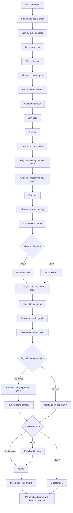
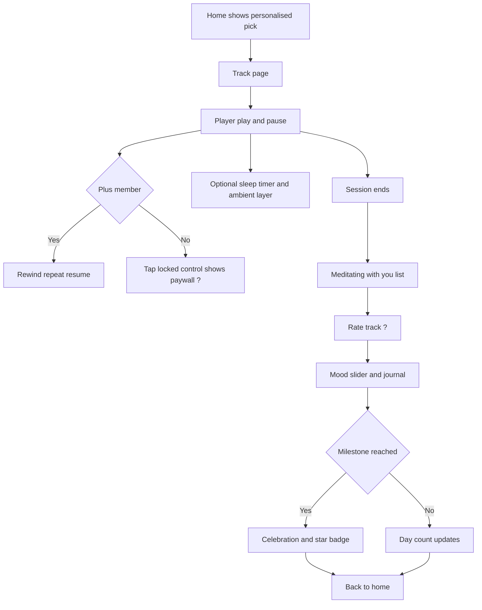
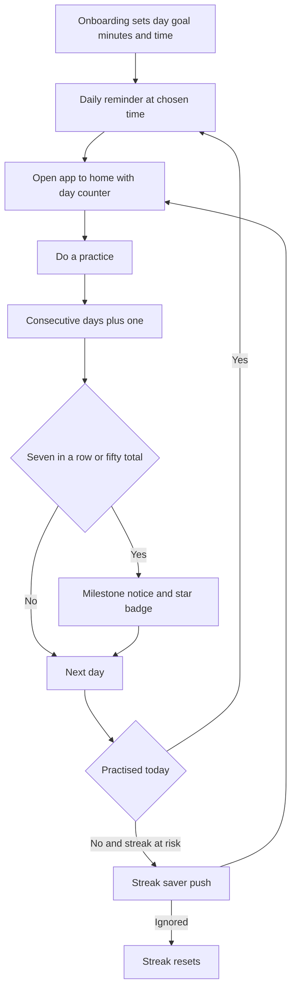
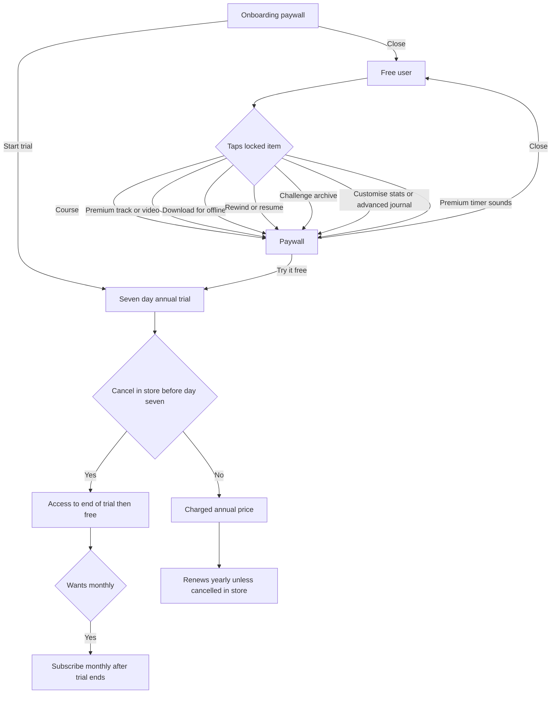
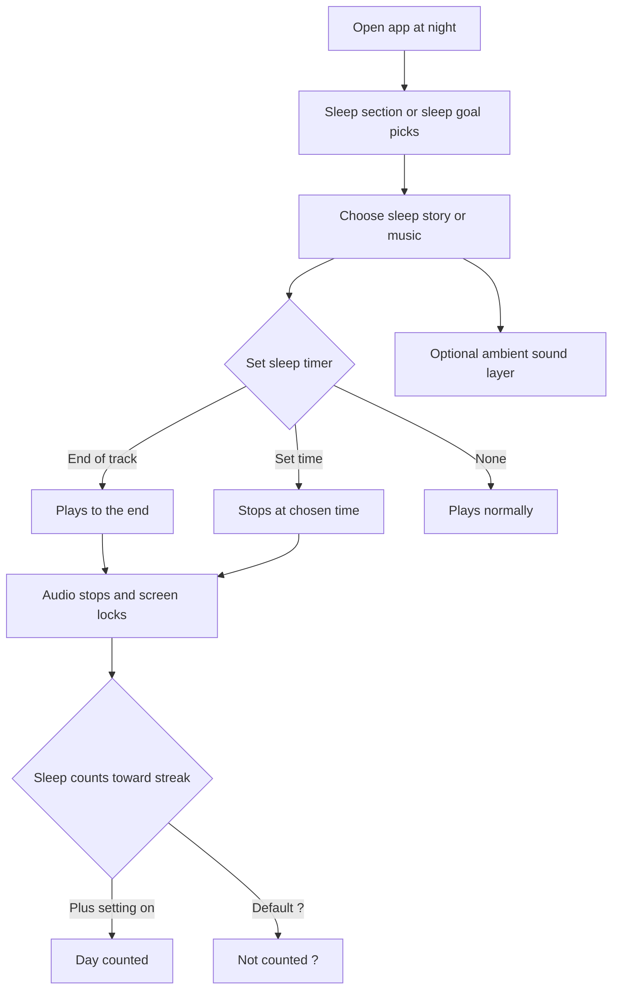
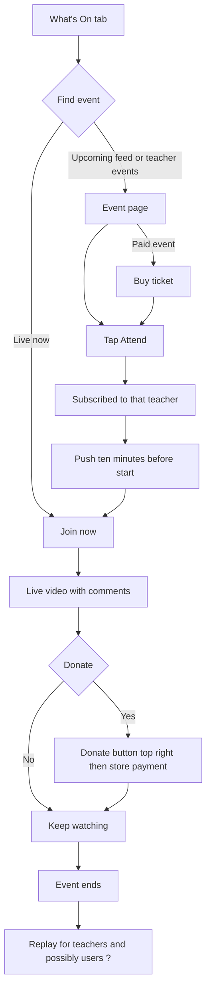
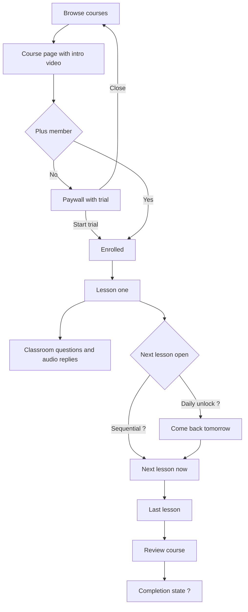
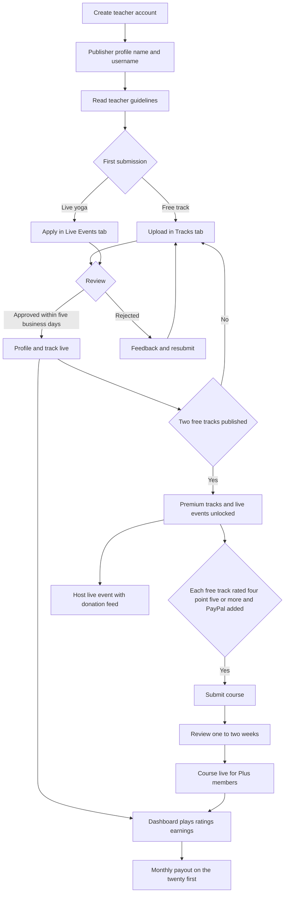
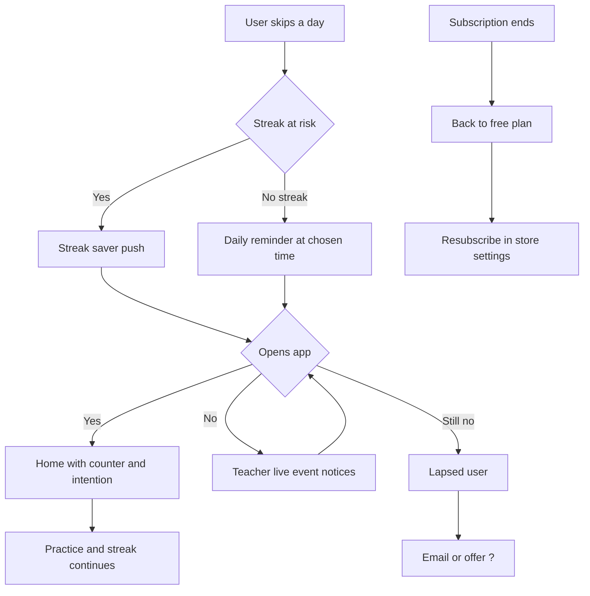

# Insight Timer: end-to-end user journeys, screen by screen (for flow charts)

Researched 2026-11-18 from public sources only. This round builds on `research_notes/Insight Timer deep research/product_features.md` and does not repeat its feature list. It covers the order of screens and the branches between them.

How to read this file:
- **Verified** means a source describes that step. The main step-by-step source is ScreensDesign's screen capture of the iOS app, which is undated and has no version number (see the onboarding section). The other main source is the Insight Timer help center (insight-timer.freshdesk.com, which help.insighttimer.com points to); each article's last-updated date is given.
- **Inferred** means I joined verified steps together, or filled a step that must exist for the flow to work. Every Mermaid chart sits under Inferences because it connects verified steps with inferred edges. In the charts, `?` marks a step that no source shows.
- Sources I could not use: Mobbin, Page Flows and Appservatory's case study are behind paywalls, and Appservatory's full breakdown is members-only. No YouTube walkthrough was fetched. I found only one relevant Reddit thread.

## 1. First open and onboarding (sign-up, questions, personalisation, notifications, trial offer)

### Takeaway
The onboarding is a long questionnaire: about 25 steps, over two and a half minutes. It asks who the app is for, interests (up to three), experience, birth year, gender, mood, a consecutive-day goal, minutes a day, time of day, a goal and how you found the app. It asks for notification permission in the middle of the questions. It then shows a "projected results" graph and a 7-day free trial explainer, followed by two paywall screens, all before you create an account. You sign up after the paywall, through social login or email with verification, then set your name and profile privacy, and land on a personalised home screen.

### Cited Findings
- ScreensDesign's capture of the iOS onboarding, in this order: (1) splash logo; (2) splash with a daily user count and an Iain S. Thomas quote; (3) a donut chart and the button "Join 35 Million People"; (4) a library preview with category cards and a progress bar; (5) "Who you are here to support", with "Myself" selected; (6) a modal saying "maximum of three topics"; (7) a topic grid with three picked; (8) meditation experience, three cards; (9) a content-interest tag grid; (10) birth year picker; (11) gender, asked "to personalize recommendations"; (12) mood check, from "Terrible" to "Great"; (13) an education screen with an equanimity progress chart; (14) consistency education with a day selector and slider; (15) consecutive-day goal, "three-day" selected; (16) "Goal Set" confirmation; (17) practice benefits with a daily-minutes chart; (18) daily duration, "five minutes" selected; (19) practice time: morning, afternoon, evening or "not sure"; (20) two notification permission screens with the system prompt and a Continue button; (21) goal selection, four options including "Sleep Better" and "Manifesting"; (22) "How did you find the app?"; (23) projected results graph, a "scientific verification" card and "Let's do this"; (24) a 7-day free trial timeline with cancellation instructions and "Try it free"; (25) paywall 1, a Free vs Plus feature table with a testimonial and "Try it free"; (26) paywall 2, a feature list, testimonial and pricing details; (27) checkout, "Insight Premium Meditation", one-week free trial at annual pricing, then Apple's payment sheet; (28) purchase success; (29) four Plus welcome screens: unlimited courses, premium tracks, challenge archive, milestones/journal; (30) sign-up modal with social logins and email; (31) email and password; (32) email verification with Edit and Resend; (33) name; (34) privacy, "Public Profile" selected, Finish; (35) "Tap to Continue"; (36) personalisation screen with a featured teacher card (Jack Kornfield) and a progress bar. The page gives no capture date or version. — [ScreensDesign app page](https://screensdesign.com/apps/insight-timermeditate-sleep/)
- The same capture describes "25 distinct steps" over "two and a half minutes", a soft paywall "late in the onboarding flow (01:31), after the user has already invested significant time personalizing", and a paywall with "a comparison table and user testimonials". The premium tier is called "Plus". The first dashboard (02:50) "still presents a high density of options". — [ScreensDesign showcase](https://screensdesign.com/showcase/insight-timermeditate-sleep)
- A teardown says the onboarding opens with "a scientific argument for its own efficacy, graphs of mood improvement, a consistency curve, and a personalized prediction dated three months from sign-up, before showing any content or asking for payment". It also summarises: the app "asks you to set your own goal and write your own daily intention, then gives you a count of your days and other people to practice alongside" (April 2026). — [Appservatory case study](https://appservatory.com/case-studies/insight-timer/) (summary visible; full breakdown is members-only; search snippet)
- The app can be used without an account in "Guest Mode", and help articles cover what happens when a guest registers. — [Help center: Getting Started folder](https://insight-timer.freshdesk.com/support/solutions/67000385167)
- The trial is 7 days on the annual MemberPlus plan, and the plan auto-renews unless cancelled (last updated 2026-03-17). — [Help: cancel before free trial ends on iOS](https://insight-timer.freshdesk.com/support/solutions/articles/67000664699-how-do-i-cancel-before-my-free-trial-ends-on-ios-)
- After v20.17.0 (May 2026), a reviewer complained about being "forced to go through the onboarding paywall flow every time". The same analysis read the redesign as pushing "premium onboarding flows". — [MWM, May 2026](https://mwm.ai/articles/app-updates/insight-timer-v20-17-0-buries-saved-meditations-in-bloated-redesign-may-2026)
- The January 2026 launch added resolutions shown on the home screen all year and prompts to set daily intentions, powered by an "AI recommendation engine". — [GlobeNewswire, 2026-01-06](https://www.globenewswire.com/news-release/2026/01/06/3213643/0/en/insight-timer-launches-new-year-s-resolution-and-intention-setting-featu)
- Reteno's gallery lists an Insight Timer push/onboarding flow tagged "Short flow (30- steps)", "Free trial", "Welcome gift / Discount", "Tips", and dated 21.07.2025. But the one notification it shows ("Got 5 minutes? Time for a tiny French lesson", +1h after onboarding) is plainly from another app. **Treat this page as unreliable.** — [Reteno gallery](https://gallery.reteno.com/flows/push-notifications-insight-timer)

### Inferences
- The ScreensDesign sequence is the best public record. Because it has no date, I can only assume it is current (2025–2026). Two details support that: "Plus" naming, and a "35 Million" figure close to the 32M+ cited in January 2026.
- **The paywall comes before account creation.** In the capture, the user who signs up does so after purchase or after dismissing the paywall. Together with Guest Mode, this suggests a user who dismisses the paywall can skip sign-up and reach home as a guest. That is inferred; the capture only shows the path where the user buys.
- How the paywall is dismissed (an X, or "Not now") is not shown by any source. It is called "soft", so a close control exists. Users who close paywall 1 may then see paywall 2 or a discount; Reteno's tags hint at a "welcome discount", but that source is unreliable.
- The trial explainer (24) is likely a "how your trial works" timeline (today, a reminder around day 5, charge on day 7), the standard pattern. The capture says only "7-day free trial timeline, cancellation instructions". The reminder day is not verified.

### Gaps
- No source shows the paywall close control, a second "discount" paywall after dismissal, or the actual on-screen prices.
- The meditation experience option labels and the full topic and goal lists were not captured.
- Android ordering was not verified; the Play listing did not render in earlier work.
- I could not confirm whether the onboarding paywall reappears on every launch for free users (one complaint says so after v20.17.0).

## 2. First session (what is recommended, player, end of session)

### Takeaway
After onboarding, home leads with a personalised pick: a featured teacher card based on the answers. The player offers a sleep timer and lets you layer ambient sounds over a guided track. When a session ends, a reflection screen shows a mood slider and a journaling space. A "meditating with you" list of other users and a milestone celebration (if one is reached) come with the end of a session. Rewind, fast-forward, repeat and resume are MemberPlus-only, so a free player is basically play and pause.

### Cited Findings
- The player has a sleep timer and ambient sound layering over a guided track (05:23, 05:38). The post-session reflection is "a mood slider and journaling space" (06:55). The timer lets you build unguided sessions with bells and ambient sounds, and "a pop-up explains the new timer for Plus members" (13:46). — [ScreensDesign showcase](https://screensdesign.com/showcase/insight-timermeditate-sleep)
- The last onboarding screen is personalisation with a featured teacher card (Jack Kornfield). — [ScreensDesign app page](https://screensdesign.com/apps/insight-timermeditate-sleep/)
- Users can hide their profile from the post-meditation "meditating with you" list. — [Help center: Community folder](https://insight-timer.freshdesk.com/support/solutions/67000385167) (via the earlier research notes)
- Repeat, fast-forward and rewind, and resume are MemberPlus "advanced player controls". — [Help: What is MemberPlus?](https://insight-timer.freshdesk.com/support/solutions/articles/67000664702-what-is-memberplus-)
- Reaching a milestone triggers a celebration notification and a new star badge on the profile. — [Help: How do milestones work?](https://insight-timer.freshdesk.com/support/solutions/articles/67000698008-how-do-milestones-work-)
- Teachers' tracks are rated in stars; the average rating gates teacher privileges (4.5+). This means listeners are asked to rate tracks. — [Instructions and requirements for courses](https://insight-timer.freshdesk.com/support/solutions/articles/67000664708-instructions-and-requirements-for-courses)

### Inferences
- The end-of-session order is likely: completion, then the "meditating with you" list, a star rating, the mood slider and journal, and a milestone or streak update. The individual pieces are verified; their order is not.
- The donation and share prompts probably appear on the end screen too. Donations from track pages are verified (17:15 in the capture), but their placement on the end screen is not.

### Gaps
- No source showed the exact end-screen order, a share prompt, or whether the mood slider is free or MemberPlus. The "advanced journal" is MemberPlus, so a basic note is probably free.
- What happens when a free user taps a locked control was not observed.

## 3. Habit formation (reminders, streaks, milestones, stats, daily picks, saved)

### Takeaway
The habit loop is built on the consecutive-day goal set in onboarding (for example 3 days) and a home-screen day counter. "Streak Saver" pushes arrive when a streak is at risk. Milestones come at 7 consecutive days or 50 total days, each adding a star badge: yellow at 1, red at 5, green at 25, blue at 100. MemberPlus users can choose which activities count. January 2026 added year-long resolutions and daily intentions on home. A "My Routine" daily checklist and a Saved tab with bookmarks, playlists, listen later and folders complete the loop.

### Cited Findings
- Milestones: "7 consecutive days of meditation or 50 non-consecutive days". Each triggers a celebration notification and a star badge visible to others (yellow 1, red 5, green 25, blue 100). Last updated 2026-03-17. — [Help: How do milestones work?](https://insight-timer.freshdesk.com/support/solutions/articles/67000698008-how-do-milestones-work-)
- Older third-party accounts describe a gold star for every 10 consecutive days, with five gold stars turning into a red star. **This is the older flow (around 2020) and superseded.** — [Manas Saloi, 2020](https://manassaloi.com/2020/05/15/meditation-app-streak.html) (via search summary)
- Streak Saver "sends you push notifications when you're at risk of losing your meditation streak". Turn it off at Menu (top left), then Settings, then "Encouragement & Notifications", then the Streak Saver toggle. The streak stays visible on the profile. Related articles cover daily reminder notifications. Last updated 2026-03-19. — [Help: disable Streak Saver](https://insight-timer.freshdesk.com/support/solutions/articles/67000739886-how-do-i-disable-streak-saver-notifications-in-the-insight-timer-app-)
- Customize Stats (MemberPlus) lives at Menu, then Settings, then Features & Preferences, then Customize Stats. It controls a "Home Screen Counter" for the consecutive-day count and which activities count toward streaks and milestones: Sleep Tracks, Music, Talks, Courses, Live Events, Check-Ins, Journal, Intentions, Gratitude Wall, Quotes Reflections. Last updated 2026-03-19. — [Help: customize stats](https://insight-timer.freshdesk.com/support/solutions/articles/67000714307-can-i-customize-my-stats-in-the-app-)
- Onboarding sets the consecutive-day goal, minutes per day and time of day, and asks for notification permission. — [ScreensDesign app page](https://screensdesign.com/apps/insight-timermeditate-sleep/)
- The capture shows "My Routine", a checklist of daily wellness activities (11:31); challenges that are "time-bound events with dedicated discussion forums", followed by an invite-friends prompt (02:53–03:39); and bookmarks, listen later and custom folders. — [ScreensDesign showcase](https://screensdesign.com/showcase/insight-timermeditate-sleep)
- Resolutions on home all year, plus daily intention prompts (January 2026). — [GlobeNewswire](https://www.globenewswire.com/news-release/2026/01/06/3213643/0/en/insight-timer-launches-new-year-s-resolution-and-intention-setting-featu)
- One unverified third-party claim describes a 7-to-30-day trial extension tied to the first milestone and the home-screen widget. — [Strivecloud](https://strivecloud.io/?p=152240) (via search summary; **unverified, treat with caution**)
- The May 2026 redesign moved bookmarks and drew a backlash. — [MWM](https://mwm.ai/articles/app-updates/insight-timer-v20-17-0-buries-saved-meditations-in-bloated-redesign-may-2026)

### Inferences
- For free users, only meditation (and the timer) likely counts toward the streak by default, because widening what counts is MemberPlus. That would make a streak harder to keep on the free plan, a quiet nudge to upgrade. Inferred from the MemberPlus gating.
- Home probably changes over the first weeks from "featured teacher and recommendations" to "counter, resolution or intention, routine, continue where you left off". This is inferred; I found no dated sequence of home states.

### Gaps
- The daily reminder timing and copy, the Streak Saver send time, and whether a "Daily Insight" or daily pick card still exists on home in 2026 were not verified.
- The structure of the stats screen (charts, totals, time meditated) was not captured beyond the customisation settings.

## 4. Conversion (every MemberPlus offer and lock, trial, price, cancellation)

### Takeaway
MemberPlus is offered first, and hardest, at the end of onboarding: a 7-day trial of the annual plan (US$59.99 a year; US$9.99 a month is only available after the trial). After that, the locks a user meets are courses (MemberPlus-only since buying single courses was dropped), premium tracks and videos, downloads, rewind and resume, the challenge archive, Customize Stats, the advanced journal, premium timer sounds and the timer's "new timer for Plus" pop-up. Cancellation happens in the app store, not in the app.

### Cited Findings
- 7-day free trial on the annual plan, auto-renews. Cancel on iOS at Settings, then Apple ID, then Subscriptions, then Insight Timer, then Cancel Subscription, then confirm. Access lasts until the trial ends. Monthly ($9.99) can be chosen only after the trial; annual is $59.99. Last updated 2026-03-17. — [Help: cancel before trial ends on iOS](https://insight-timer.freshdesk.com/support/solutions/articles/67000664699-how-do-i-cancel-before-my-free-trial-ends-on-ios-)
- To subscribe monthly, you start the 7-day trial and cancel it, and then subscribe monthly once it expires. Unused trial time is forfeited if you buy a plan during the trial. — [Help: How do I subscribe?](https://insight-timer.freshdesk.com/support/solutions/articles/67000680587-how-do-i-subscribe-to-insight-timer-) (via search summary); [RecurDash cancel guide](https://recurdash.com/guides/how-to-cancel-insight-timer) (third party)
- Buying individual courses "isn't available as a standalone option"; courses come with MemberPlus. Last updated 2026-03-19. — [Help: How do I purchase a course?](https://insight-timer.freshdesk.com/support/solutions/articles/67000664582-how-do-i-purchase-a-course-on-insight-timer-)
- Onboarding paywall: Free vs Plus table, testimonials, "Try it free", then the Apple sheet for "Insight Premium Meditation", then four Plus welcome screens. — [ScreensDesign app page](https://screensdesign.com/apps/insight-timermeditate-sleep/)
- Inside the app, a timer pop-up "explains the new timer for Plus members". — [ScreensDesign showcase](https://screensdesign.com/showcase/insight-timermeditate-sleep)
- Customize Stats is MemberPlus. — [Help: customize stats](https://insight-timer.freshdesk.com/support/solutions/articles/67000714307-can-i-customize-my-stats-in-the-app-)
- A paid "Live Event Ticket" in-app purchase ($3.49) exists alongside the subscription. — [App Store listing](https://apps.apple.com/us/app/insight-timer-meditation-app/id337472899)
- Lapsed subscribers resubscribe through the device's expired-subscriptions list. — [Help: How do I subscribe?](https://insight-timer.freshdesk.com/support/solutions/articles/67000680587-how-do-i-subscribe-to-insight-timer-) (via search summary)
- Reddit (2024): "a lot of the features that would help my meditation are behind a paywall". The reply: "they often have sales or promotions". — [r/Meditation, 2024 (mirror)](https://cal1.lr.ggtyler.dev/r/Meditation/comments/1ch859b/just_started_using_insight_timer_and_it_is_great)

### Inferences
- Funnel shape: one hard push in onboarding, then contextual locks. A lock badge on a premium track or course, or a tap on rewind, a download or the archive, leads to the paywall. These are the standard pattern and are inferred; I found no capture of an in-app lock screen.
- There is no in-app cancellation flow. There is no retention offer screen inside the app, because cancellation goes through Apple or Google settings. Any "save" offer would come by email or push, and none was found.

### Gaps
- No public capture of an in-app lock or paywall after onboarding, discount offers, regional prices or a trial-ending reminder.
- Whether free listening carries ads ("ad-free" appears in one help article) remains unconfirmed.

## 5. The sleep flow

### Takeaway
Sleep is a content category (sleep tracks, music, stories) with a Sleep Mode / Sleep Timer that stops playback at the end of the track or at a set time, then locks the screen. Ambient sounds can be layered over a track. Sleep Mode does not work with Courses and hides "Add Extra Time". "Sleep Better" is one of the onboarding goals.

### Cited Findings
- Sleep Mode "automatically stops your meditation or sleep track at the end of your session and locks your device screen". The track stops "at a specific time you choose, if you've set one". "Add Extra Time" is hidden. "Sleep Mode is not available for Courses." Last updated 2026-07-20. — [Help: What is Sleep Timer / Sleep Mode](https://insight-timer.freshdesk.com/support/solutions/articles/67000742206-what-is-sleep-timer-and-how-does-it-work-)
- The player has a sleep timer and ambient sound layering. — [ScreensDesign showcase](https://screensdesign.com/showcase/insight-timermeditate-sleep)
- "Sleep Better" is an onboarding goal option. — [ScreensDesign app page](https://screensdesign.com/apps/insight-timermeditate-sleep/)
- An open-ended timer (∞) runs until stopped by hand. — [Help: open-ended timer](https://insight-timer.freshdesk.com/support/solutions/articles/67000664921-how-can-i-set-an-open-ended-timer-session-)
- Sleep tracks can be set to count toward the streak (MemberPlus setting). — [Help: customize stats](https://insight-timer.freshdesk.com/support/solutions/articles/67000714307-can-i-customize-my-stats-in-the-app-)

### Inferences
- A night flow: home or the Sleep section, then a sleep story or music, then optionally Sleep Mode or a time and an ambient layer, then playback, an automatic stop and the screen locking. A morning check-in or streak credit applies only if sleep counts. Whether there is a dark theme at night was not verified.

### Gaps
- No source covered dark mode, the steps to activate Sleep Mode, whether Sleep Mode is free, or the share of sleep stories that are premium.

## 6. Live events flow

### Takeaway
Discover live events in What's On (Live Now, the events feed, a teacher's Events) or in the Saved tab's Live Events. Tap Attend, which also subscribes you to that teacher's sessions. A push arrives 10 minutes before the start. Join from the list. Inside, comments run alongside and a donate button sits top right. Standard events are free; a paid ticket ($3.49) exists. Replays are for teachers only, but one help title suggests some user-facing replay exists.

### Cited Findings
- The discovery path is What's On, then Teacher Updates, then Teachers, then a teacher, then Events; or Saved, then Live Events (added via Edit if it is missing). On the web: filters by teacher, topic or time, with Add to Calendar / Notify Me. "Attend" sends a notification 10 minutes before the start; cancellations send an in-app notification. Last updated 2026-08-13. — [Help: join and watch live events](https://insight-timer.freshdesk.com/support/solutions/articles/67000665057-how-can-i-join-and-watch-live-events-on-insight-timer-)
- Signing up for one teacher's event subscribes you to notifications for all of that teacher's sessions. — earlier notes citing the same help folder ([product_features.md](./../Insight%20Timer%20deep%20research/product_features.md))
- "Once inside a Live session, the donation button will appear at the top right." Donations are optional and events free. The host's stats panel shows a donation feed sortable by time or amount. — [Help: rules and guidelines for live events](https://insight-timer.freshdesk.com/support/solutions/articles/67000664902-rules-and-guidelines-for-live-events); [Help: live hosting screen](https://insight-timer.freshdesk.com/support/solutions/articles/67000744273-understanding-the-live-event-hosting-screen) (via search summary)
- Comments cannot be downloaded. Teachers rewatch, with comments, at Dashboard, then Past, then Watch Replay. Replays are "exclusively accessible to teachers" and cannot be downloaded. User-facing titles include "How Can I Hide or Disable Comments During a Live Event?" and "How Can I Watch Live Event Replays?" — [Help: rules and guidelines](https://insight-timer.freshdesk.com/support/solutions/articles/67000664902-rules-and-guidelines-for-live-events); [Help: join and watch](https://insight-timer.freshdesk.com/support/solutions/articles/67000665057-how-can-i-join-and-watch-live-events-on-insight-timer-)
- An older company post gives an 85/15 donation split after store fees. The current help center says 100% goes to teachers, so the 85/15 split is **older**. — [Insight Timer on Medium](https://medium.com/insighttimer/theres-an-elephant-in-the-meditation-room-854696eb0967)
- Live events can be shared with friends or on social media. — [Help: share live events](https://insight-timer.freshdesk.com/support/solutions/articles/67000665063-how-to-share-live-events-with-my-friends-and-social-media-)

### Inferences
- The replay situation conflicts. The rules say replays are for teachers only, but a user-facing "How can I watch live event replays?" exists. Either users get replays now (newer) or the article covers a limited case. Unresolved.

### Gaps
- The in-event chat UI, reactions, post-event screen and the user replay rules were not verified, and no ticketed-event flow was found.

## 7. Courses flow

### Takeaway
Courses are MemberPlus-only. Buying single courses is no longer offered; the help article updated 2026-03-19 says so, but I could not date the change. A course has 3 or more lessons, typically 5–10, each 3–40 minutes. Students are encouraged to start at Lesson 1, can ask questions in a teacher-moderated classroom where teachers reply by audio, and can leave reviews. No source states whether lessons unlock one per day or are all open, or what completion looks like.

### Cited Findings
- At least 3 lessons, suggested 5–10, each 3–40 minutes (typically 7–15). "Encourage students to start from Lesson 1." Students leave reviews. Courses are MemberPlus-only. Editorial review takes 1–2 weeks. Last updated 2026-08-18. — [Help: instructions and requirements for courses](https://insight-timer.freshdesk.com/support/solutions/articles/67000664708-instructions-and-requirements-for-courses)
- No standalone course purchase. — [Help: purchase a course](https://insight-timer.freshdesk.com/support/solutions/articles/67000664582-how-do-i-purchase-a-course-on-insight-timer-)
- Courses are taken "with daily or sequential lessons", with a classroom where teachers reply "with real-time audio". — [Help: What is MemberPlus?](https://insight-timer.freshdesk.com/support/solutions/articles/67000664702-what-is-memberplus-) (via the earlier notes)
- Sleep Mode does not work in courses. — [Help: Sleep Timer](https://insight-timer.freshdesk.com/support/solutions/articles/67000742206-what-is-sleep-timer-and-how-does-it-work-)
- Before 2025 the model was paying for each course. **That is the older flow.** — inferred from the help article saying standalone purchase "isn't available"; the switch date is unknown

### Inferences
- "Daily or sequential" suggests both modes exist, chosen per course by the teacher. Inferred.

### Gaps
- The unlock rules, a completion badge or certificate, progress UI and the course survey timing were not verified.

## 8. Teacher / creator flow

### Takeaway
Becoming a teacher is free and non-exclusive. You create a teacher account and Publisher Profile, read the guidelines and upload a free track. A review publishes the profile and track within 5 business days. Two published free tracks unlock premium tracks, courses and live events; courses also need a 4.5+ star average per track and PayPal details, and take 1–2 weeks to review. From the dashboard, teachers see plays, ratings and earnings. They earn a share of MemberPlus revenue (weighted by type, plus a Return Rate bonus) and 100% of donations, paid monthly.

### Cited Findings
- "It's free to become a teacher. No exclusivity requirements." Upload a free track through the "Tracks" tab, or apply for live yoga through the "Live Events" tab. The profile goes live only after review: "your track will be published within 5 business days". "After publishing 2 Free Tracks, you will unlock the ability to publish Premium Content (Premium Tracks and Courses) and host Live Events." Read the Guidelines for Teachers first. — [Help: How do I become a teacher? (Dutch)](https://insight-timer.freshdesk.com/support/solutions/articles/67000664779-hoe-word-ik-docent-op-insight-timer-); [Help: Teacher profile requirements](https://insight-timer.freshdesk.com/support/solutions/articles/67000664576-teacher-profile-requirements); [Help: What content is accepted](https://insight-timer.freshdesk.com/support/solutions/articles/67000664794-what-kind-of-content-does-insight-timer-accept-) (via search summary)
- Course requirements: 2 free tracks each averaging 4.5+ stars, copyright, qualifications, PayPal on the profile, accreditations under Publisher Profile, then Accreditations, and MP3 at 192 kbps+ / 44.1 kHz. Review takes 1–2 weeks, with feedback if rejected. The dashboard shows plays per lesson, plays, ratings and earnings. — [Help: course requirements](https://insight-timer.freshdesk.com/support/solutions/articles/67000664708-instructions-and-requirements-for-courses)
- The live hosting screen has a stats panel and a donation feed; teachers can rewatch past events with comments. — [Help: live hosting screen](https://insight-timer.freshdesk.com/support/solutions/articles/67000744273-understanding-the-live-event-hosting-screen); [Help: rules and guidelines](https://insight-timer.freshdesk.com/support/solutions/articles/67000664902-rules-and-guidelines-for-live-events)
- Earnings: a subscription share weighted by content type, the Return Rate bonus (25–30% of teacher income), 100% of donations, and payouts on the 21st through Tipalti with a $10 minimum. The 2024 FAQ is the source. — [Help: Teacher Income FAQ August 2024](https://insight-timer.freshdesk.com/support/solutions/articles/67000737721-teacher-income-faq-august-2024)
- AI-generated content is banned; all content is reviewed before publishing. — earlier notes ([product_features.md](./../Insight%20Timer%20deep%20research/product_features.md))

### Inferences
- The flow ladders up: free tracks build an audience and a rating, which then unlocks the earning formats. Ratings from listeners are what move a teacher up that ladder.

### Gaps
- The application form fields, the live-event proposal review time and the paid-live-event (ticket) revenue split were not found.

## 9. Churn and return (bringing lapsed users back)

### Takeaway
The verified re-engagement levers are all inside the app's own notification system: the daily reminder set in onboarding, Streak Saver pushes when a streak is at risk, milestone celebration notices, 10-minute live-event reminders, and notifications from teachers you have attended. Lapsed subscribers resubscribe through the app store. I found no reliable public record of win-back emails, lapsed-user discounts or cancellation save offers.

### Cited Findings
- Streak Saver pushes, plus related daily reminder notifications, are set at Settings, then Encouragement & Notifications. — [Help: disable Streak Saver](https://insight-timer.freshdesk.com/support/solutions/articles/67000739886-how-do-i-disable-streak-saver-notifications-in-the-insight-timer-app-)
- Milestone celebration notifications. — [Help: milestones](https://insight-timer.freshdesk.com/support/solutions/articles/67000698008-how-do-milestones-work-)
- Live-event reminders and teacher subscriptions. — [Help: join live events](https://insight-timer.freshdesk.com/support/solutions/articles/67000665057-how-can-i-join-and-watch-live-events-on-insight-timer-)
- The Return Rate teacher bonus pays teachers whose listeners come back the next day and complete an activity. — [Help: Teacher Income FAQ](https://insight-timer.freshdesk.com/support/solutions/articles/67000737721-teacher-income-faq-august-2024)
- Resolutions on home all year as a daily reminder (January 2026). — [GlobeNewswire](https://www.globenewswire.com/news-release/2026/01/06/3213643/0/en/insight-timer-launches-new-year-s-resolution-and-intention-setting-featu)
- Searches for a "50% off" or win-back offer found nothing; the only "50%" figure is the annual-versus-monthly saving. — [RecurDash pricing](https://recurdash.com/subscription-pricing/insight-timer)

### Inferences
- Insight Timer outsources part of retention to teachers. The Return Rate bonus pays creators to make content people come back to the next day, and teacher subscriptions turn each attended live event into a stream of future notifications.

### Gaps
- No source showed email cadence, copy, win-back discounts, the days after which a user counts as lapsed, or the in-app "welcome back" state. Reteno's tags hinted at a "welcome discount", but the page is unreliable, as noted in section 1.
